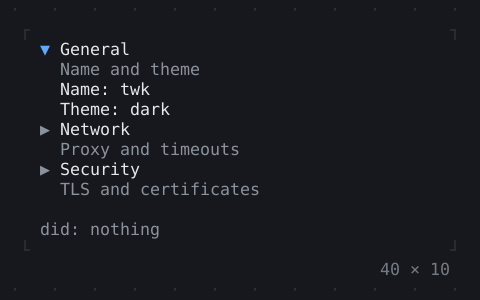
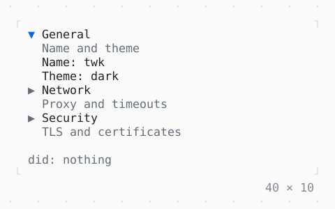

# ExpansionTile, Accordion

Sections that fold under their headers: Enter, Space or a click opens one, Right and Left open and close it; in an accordion one is open at a time, Up and Down go from header to header.

| Dark | Light |
| --- | --- |
|  |  |

## Code

The Dart that builds it, as the gallery's Code tab shows it with the
options as they start:

```dart
var _verify = true;
var _did = '';

/// A section of [title] that holds [child], and says when it opens or
/// closes.
ExpansionTile _section(
  String title,
  String subtitle,
  Widget child, {
  bool open = false,
}) => ExpansionTile(
  title: Text(title),
  subtitle: Text(subtitle),
  initiallyExpanded: open,
  onExpansionChanged: (expanded) => setState(
    () => _did = '${expanded ? 'opened' : 'closed'} $title',
  ),
  child: child,
);

@override
Widget build(BuildContext context) {
  final theme = Theme.of(context);
  final sections = [
    _section(
      'General', 'Name and theme',
      const Text('Name: twk\nTheme: dark'),
      open: true,
    ),
    _section('Network', 'Proxy and timeouts', const Text('Proxy: none\nTimeout: 30 s')),
    _section(
      'Security', 'TLS and certificates',
      Column(
        mainAxisSize: .min,
        crossAxisAlignment: .start,
        children: [
          const Text('TLS: 1.3'),
          Checkbox(
            value: _verify,
            label: 'verify certificates',
            onChanged: (value) => setState(() => _verify = value),
          ),
        ],
      ),
    ),
  ];
  return Column(
    mainAxisSize: .min,
    crossAxisAlignment: .start,
    gap: 1,
    children: [
      SizedBox(
        width: 40,
        child: Accordion(children: sections),
      ),
      Text.rich([
        Span('did: ', theme.muted),
        if (_did.isEmpty)
          Span('nothing', theme.muted)
        else
          Span(_did),
      ]),
    ],
  );
}
```

## Options

What the gallery lets you change, and what each starts at:

| option | values | starts at |
| --- | --- | --- |
| in an accordion | on, off | true |
| several open | on, off | false |
| subtitles | on, off | true |
| duration | 150 ms, 400 ms, none | 150 ms |

## More

- API: [`ExpansionTile`](https://pub.dev/documentation/twk/latest/twk/ExpansionTile-class.html), [`Accordion`](https://pub.dev/documentation/twk/latest/twk/Accordion-class.html).
- Also in Layout: [Box](box.md), [ColoredBox, DecoratedBox](coloredbox-decoratedbox.md), [Container](container.md), [Divider](divider.md), [Shadow](shadow.md), [Padding](padding.md), [Align, Center](align-center.md), [SizedBox](sizedbox.md), [ConstrainedBox](constrainedbox.md), [LimitedBox, OverflowBox](limitedbox-overflowbox.md), [FractionallySizedBox](fractionallysizedbox.md), [IntrinsicWidth/Height](intrinsicwidth-height.md), [Row, Column, Flex](row-column-flex.md), [Expanded, Spacer](expanded-spacer.md), [Stack, Positioned](stack-positioned.md), [Transform](transform.md), [Visibility, Offstage](visibility-offstage.md), [Grid, GridPlacement](grid-gridplacement.md), [Wrap](wrap.md), [CustomPaint](custompaint.md), [SplitView](splitview.md), [DockArea](dockarea.md), [Scaffold](scaffold.md).
- Live in the gallery:
  `dart run packages/gallery/bin/gallery.dart --route='#/layout/expansiontile-accordion'`.
- [Layout](../layout.md) · [All groups](../README.md)
