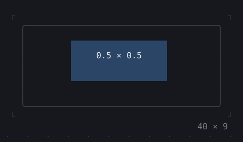
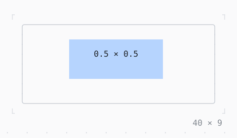

# FractionallySizedBox

A child a fraction of the room it is given.

| Dark | Light |
| --- | --- |
|  |  |

## Code

The Dart that builds it, as the gallery's Code tab shows it with the
options as they start:

```dart
final theme = Theme.of(context);
return SizedBox(
  width: 40,
  height: 9,
  child: Box(
    border: .all(type: .rounded, style: theme.border),
    child: FractionallySizedBox(
      widthFactor: 0.5,
      heightFactor: 0.5,
      child: Box(
        style: theme.selection,
        child: const Center(child: Text('0.5 × 0.5')),
      ),
    ),
  ),
);
```

## Options

What the gallery lets you change, and what each starts at:

| option | values | starts at |
| --- | --- | --- |
| width factor | ¼, ½, ¾, 1 | ½ |
| height factor | ¼, ½, ¾, 1 | ½ |
| alignment | center, topLeft, bottomRight | center |
| room | 16 cells to 48 cells | 40 |

## More

- API: [`FractionallySizedBox`](https://pub.dev/documentation/twk/latest/twk/FractionallySizedBox-class.html).
- Also in Layout: [Box](box.md), [ColoredBox, DecoratedBox](coloredbox-decoratedbox.md), [Container](container.md), [Divider](divider.md), [Shadow](shadow.md), [Padding](padding.md), [Align, Center](align-center.md), [SizedBox](sizedbox.md), [ConstrainedBox](constrainedbox.md), [LimitedBox, OverflowBox](limitedbox-overflowbox.md), [IntrinsicWidth/Height](intrinsicwidth-height.md), [Row, Column, Flex](row-column-flex.md), [Expanded, Spacer](expanded-spacer.md), [Stack, Positioned](stack-positioned.md), [Transform](transform.md), [Visibility, Offstage](visibility-offstage.md), [ExpansionTile, Accordion](expansiontile-accordion.md), [Grid, GridPlacement](grid-gridplacement.md), [Wrap](wrap.md), [CustomPaint](custompaint.md), [SplitView](splitview.md), [DockArea](dockarea.md), [Scaffold](scaffold.md).
- Live in the gallery:
  `dart run packages/gallery/bin/gallery.dart --route='#/layout/fractionallysizedbox'`.
- [Layout](../layout.md) · [All groups](../README.md)
