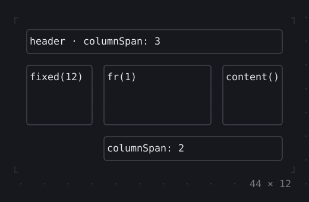
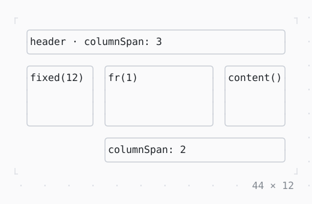

# Grid, GridPlacement

Children in the cells of tracks: fixed, a share of the rest, or as long as their content; a child may span several.

| Dark | Light |
| --- | --- |
|  |  |

## Code

The Dart that builds it, as the gallery's Code tab shows it with the
options as they start:

```dart
final theme = Theme.of(context);
Widget cell(String label) => Box(
  border: .all(type: .rounded, style: theme.border),
  child: Text(label),
);
return SizedBox(
  width: 44,
  height: 12,
  child: Grid(
    columns: const [.fixed(12), .fr(1), .content()],
    rows: const [.content(), .fr(1), .content()],
    columnGap: 1,
    children: [
      GridPlacement(columnSpan: 3, child: cell('header · columnSpan: 3')),
      cell('fixed(12)'),
      cell('fr(1)'),
      cell('content()'),
      GridPlacement(
        row: 2,
        column: 1,
        columnSpan: 2,
        child: cell('columnSpan: 2'),
      ),
    ],
  ),
);
```

## Options

What the gallery lets you change, and what each starts at:

| option | values | starts at |
| --- | --- | --- |
| third column | .content(), .fixed(14), .fr(1) | .content() |
| column gap | 0, 1, 2 | 1 |
| row gap | 0, 1 | 0 |
| width | 32 cells to 50 cells | 44 |

## More

- API: [`Grid`](https://pub.dev/documentation/twk/latest/twk/Grid-class.html), [`GridPlacement`](https://pub.dev/documentation/twk/latest/twk/GridPlacement-class.html).
- Also in Layout: [Box](box.md), [ColoredBox, DecoratedBox](coloredbox-decoratedbox.md), [Container](container.md), [Divider](divider.md), [Shadow](shadow.md), [Padding](padding.md), [Align, Center](align-center.md), [SizedBox](sizedbox.md), [ConstrainedBox](constrainedbox.md), [LimitedBox, OverflowBox](limitedbox-overflowbox.md), [FractionallySizedBox](fractionallysizedbox.md), [IntrinsicWidth/Height](intrinsicwidth-height.md), [Row, Column, Flex](row-column-flex.md), [Expanded, Spacer](expanded-spacer.md), [Stack, Positioned](stack-positioned.md), [Transform](transform.md), [Visibility, Offstage](visibility-offstage.md), [ExpansionTile, Accordion](expansiontile-accordion.md), [Wrap](wrap.md), [CustomPaint](custompaint.md), [SplitView](splitview.md), [DockArea](dockarea.md), [Scaffold](scaffold.md).
- Live in the gallery:
  `dart run packages/gallery/bin/gallery.dart --route='#/layout/grid-gridplacement'`.
- [Layout](../layout.md) · [All groups](../README.md)
