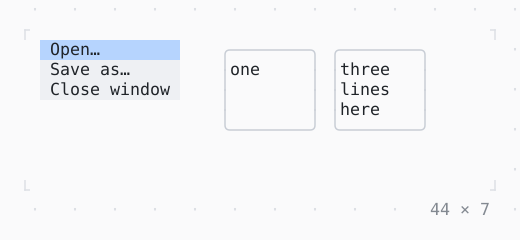

# IntrinsicWidth/Height

A child as wide or as tall as it would like to be: stretched items all as wide as the widest, boxes all as tall as the tallest.

| Dark | Light |
| --- | --- |
|  |  |

## Code

The Dart that builds it, as the gallery's Code tab shows it with the
options as they start:

```dart
final theme = Theme.of(context);
final menu = Column(
  crossAxisAlignment: .stretch,
  children: [
    for (final (i, label) in ['Open…', 'Save as…', 'Close window'].indexed)
      Box(
        style: i == 0 ? theme.selection : theme.surface,
        padding: const .x(1),
        child: Text(label),
      ),
  ],
);
final cards = Row(
  mainAxisSize: .min,
  crossAxisAlignment: .stretch,
  gap: 1,
  children: [
    for (final text in ['one', 'three lines here'])
      SizedBox(
        width: 10,
        child: Box(
          border: .all(type: .rounded, style: theme.border),
          child: Text(text),
        ),
      ),
  ],
);
return SizedBox(
  width: 44,
  height: 7,
  child: Row(
    crossAxisAlignment: .start,
    gap: 4,
    children: [
      IntrinsicWidth(child: menu),
      IntrinsicHeight(child: cards),
    ],
  ),
);
```

## Options

What the gallery lets you change, and what each starts at:

| option | values | starts at |
| --- | --- | --- |
| IntrinsicWidth | on, off | true |
| IntrinsicHeight | on, off | true |

## More

- Also in Layout: [Box](box.md), [ColoredBox, DecoratedBox](coloredbox-decoratedbox.md), [Container](container.md), [Divider](divider.md), [Shadow](shadow.md), [Padding](padding.md), [Align, Center](align-center.md), [SizedBox](sizedbox.md), [ConstrainedBox](constrainedbox.md), [LimitedBox, OverflowBox](limitedbox-overflowbox.md), [FractionallySizedBox](fractionallysizedbox.md), [Row, Column, Flex](row-column-flex.md), [Expanded, Spacer](expanded-spacer.md), [Stack, Positioned](stack-positioned.md), [Transform](transform.md), [Visibility, Offstage](visibility-offstage.md), [ExpansionTile, Accordion](expansiontile-accordion.md), [Grid, GridPlacement](grid-gridplacement.md), [Wrap](wrap.md), [CustomPaint](custompaint.md), [SplitView](splitview.md), [DockArea](dockarea.md), [Scaffold](scaffold.md).
- Live in the gallery:
  `dart run packages/gallery/bin/gallery.dart --route='#/layout/intrinsicwidth-height'`.
- [Layout](../layout.md) · [All groups](../README.md)
