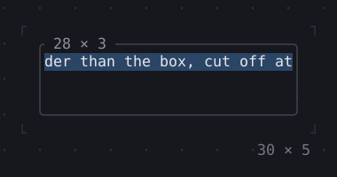
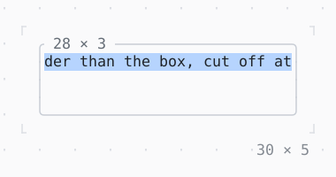

# LimitedBox, OverflowBox

Other constraints than the room gives: LimitedBox limits a child only where the room has no limit, OverflowBox and SizedOverflowBox give it others in its place, cut off where it sticks out.

| Dark | Light |
| --- | --- |
|  |  |

## Code

The Dart that builds it, as the gallery's Code tab shows it with the
options as they start:

```dart
final theme = Theme.of(context);
return SizedBox(
  width: 30,
  height: 5,
  child: Box(
    border: .all(type: .rounded, style: theme.border),
    titles: [BorderTitle(' 28 × 3 ', style: theme.muted)],
    child: OverflowBox(
      maxWidth: 48,
      child: Text(
        'a line wider than the box, cut off at its edges',
        style: theme.selection,
      ),
    ),
  ),
);
```

## Options

What the gallery lets you change, and what each starts at:

| option | values | starts at |
| --- | --- | --- |
| widget | OverflowBox, SizedOverflowBox, LimitedBox | OverflowBox |
| alignment | centerLeft, center, centerRight | center |

## More

- API: [`LimitedBox`](https://pub.dev/documentation/twk/latest/twk/LimitedBox-class.html), [`OverflowBox`](https://pub.dev/documentation/twk/latest/twk/OverflowBox-class.html).
- Also in Layout: [Box](box.md), [ColoredBox, DecoratedBox](coloredbox-decoratedbox.md), [Container](container.md), [Divider](divider.md), [Shadow](shadow.md), [Padding](padding.md), [Align, Center](align-center.md), [SizedBox](sizedbox.md), [ConstrainedBox](constrainedbox.md), [FractionallySizedBox](fractionallysizedbox.md), [IntrinsicWidth/Height](intrinsicwidth-height.md), [Row, Column, Flex](row-column-flex.md), [Expanded, Spacer](expanded-spacer.md), [Stack, Positioned](stack-positioned.md), [Transform](transform.md), [Visibility, Offstage](visibility-offstage.md), [ExpansionTile, Accordion](expansiontile-accordion.md), [Grid, GridPlacement](grid-gridplacement.md), [Wrap](wrap.md), [CustomPaint](custompaint.md), [SplitView](splitview.md), [DockArea](dockarea.md), [Scaffold](scaffold.md).
- Live in the gallery:
  `dart run packages/gallery/bin/gallery.dart --route='#/layout/limitedbox-overflowbox'`.
- [Layout](../layout.md) · [All groups](../README.md)
