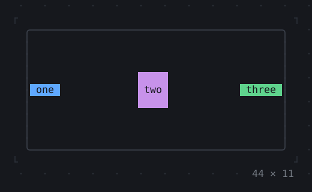
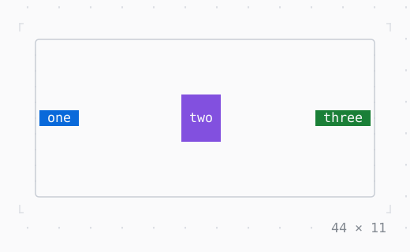

# Row, Column, Flex

Children one after another along an axis, aligned along and across it.

| Dark | Light |
| --- | --- |
|  |  |

## Code

The Dart that builds it, as the gallery's Code tab shows it with the
options as they start:

```dart
final theme = Theme.of(context);
// the text reversed too, as Badge has it: a Box gives its child its
// colours, not its attributes
Widget chip(String label, Style color, [EdgeInsets padding = const .x(1)]) {
  final reversed = color.merge(const .new(attrs: Attr.reverse));
  return Box(
    style: reversed,
    padding: padding,
    child: Text(label, style: reversed),
  );
}
return SizedBox(
  width: 44,
  height: 11,
  child: Box(
    border: .all(type: .rounded, style: theme.border),
    child: Row(
      mainAxisAlignment: .spaceBetween,
      gap: 1,
      children: [
        chip('one', theme.primary),
        chip('two', theme.accent, const .all(1)),
        chip('three', theme.success),
      ],
    ),
  ),
);
```

## Options

What the gallery lets you change, and what each starts at:

| option | values | starts at |
| --- | --- | --- |
| direction | row, column | row |
| main axis | start, end, center, spaceBetween, spaceAround, spaceEvenly | spaceBetween |
| cross axis | start, end, center, stretch | center |
| gap | 0, 1, 2 | 1 |
| main axis size | max, min | max |

## More

- API: [`Row`](https://pub.dev/documentation/twk/latest/twk/Row-class.html), [`Column`](https://pub.dev/documentation/twk/latest/twk/Column-class.html), [`Flex`](https://pub.dev/documentation/twk/latest/twk/Flex-class.html).
- Also in Layout: [Box](box.md), [ColoredBox, DecoratedBox](coloredbox-decoratedbox.md), [Container](container.md), [Divider](divider.md), [Shadow](shadow.md), [Padding](padding.md), [Align, Center](align-center.md), [SizedBox](sizedbox.md), [ConstrainedBox](constrainedbox.md), [LimitedBox, OverflowBox](limitedbox-overflowbox.md), [FractionallySizedBox](fractionallysizedbox.md), [IntrinsicWidth/Height](intrinsicwidth-height.md), [Expanded, Spacer](expanded-spacer.md), [Stack, Positioned](stack-positioned.md), [Transform](transform.md), [Visibility, Offstage](visibility-offstage.md), [ExpansionTile, Accordion](expansiontile-accordion.md), [Grid, GridPlacement](grid-gridplacement.md), [Wrap](wrap.md), [CustomPaint](custompaint.md), [SplitView](splitview.md), [DockArea](dockarea.md), [Scaffold](scaffold.md).
- Live in the gallery:
  `dart run packages/gallery/bin/gallery.dart --route='#/layout/row-column-flex'`.
- [Layout](../layout.md) · [All groups](../README.md)
