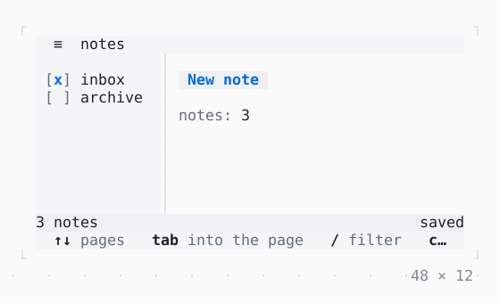

# Scaffold

An app's frame: a header, a sidebar beside the body, a status bar and the key hints, each part a zone of the focus; the sidebar collapsed on a narrow screen and resized by a drag.

| Dark | Light |
| --- | --- |
|  |  |

## Code

The Dart that builds it, as the gallery's Code tab shows it with the
options as they start:

```dart
final _controller = ScaffoldController(sidebarWidth: 14);
var _inbox = true;
var _archive = false;
var _notes = 3;

@override
void dispose() {
  _controller.dispose();
  super.dispose();
}

@override
Widget build(BuildContext context) {
  final theme = Theme.of(context);
  return SizedBox(
    width: 48,
    height: 12,
    child: Scaffold(
      controller: _controller,
      collapsedBelow: 40,
      resizableSidebar: true,
      header: const Text('notes'),
      sidebar: Padding(
        padding: const .all(1),
        child: Column(
          crossAxisAlignment: .start,
          children: [
            Checkbox(
              value: _inbox,
              label: 'inbox',
              onChanged: (v) => setState(() => _inbox = v),
            ),
            Checkbox(
              value: _archive,
              label: 'archive',
              onChanged: (v) => setState(() => _archive = v),
            ),
          ],
        ),
      ),
      body: Padding(
        padding: const .all(1),
        child: Column(
          crossAxisAlignment: .start,
          gap: 1,
          children: [
            Button('New note', onPressed: () => setState(() => _notes++)),
            Text.rich([Span('notes: ', theme.muted), Span('$_notes')]),
          ],
        ),
      ),
      statusBar: StatusBar(
        left: Text('$_notes notes'),
        right: const Text('saved'),
      ),
    ),
  );
}
```

## Options

What the gallery lets you change, and what each starts at:

| option | values | starts at |
| --- | --- | --- |
| width | 30 cells to 48 cells | 48 |
| sidebar side | left, right | left |
| resizable | on, off | true |
| key hints | on, off | true |
| header | on, off | true |
| status bar | on, off | true |
| collapsed below | none, 36, 40, 44 | 40 |

## More

- API: [`Scaffold`](https://pub.dev/documentation/twk/latest/twk/Scaffold-class.html).
- Also in Layout: [Box](box.md), [ColoredBox, DecoratedBox](coloredbox-decoratedbox.md), [Container](container.md), [Divider](divider.md), [Shadow](shadow.md), [Padding](padding.md), [Align, Center](align-center.md), [SizedBox](sizedbox.md), [ConstrainedBox](constrainedbox.md), [LimitedBox, OverflowBox](limitedbox-overflowbox.md), [FractionallySizedBox](fractionallysizedbox.md), [IntrinsicWidth/Height](intrinsicwidth-height.md), [Row, Column, Flex](row-column-flex.md), [Expanded, Spacer](expanded-spacer.md), [Stack, Positioned](stack-positioned.md), [Transform](transform.md), [Visibility, Offstage](visibility-offstage.md), [ExpansionTile, Accordion](expansiontile-accordion.md), [Grid, GridPlacement](grid-gridplacement.md), [Wrap](wrap.md), [CustomPaint](custompaint.md), [SplitView](splitview.md), [DockArea](dockarea.md).
- Live in the gallery:
  `dart run packages/gallery/bin/gallery.dart --route='#/layout/scaffold'`.
- [Layout](../layout.md) · [All groups](../README.md)
