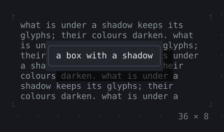
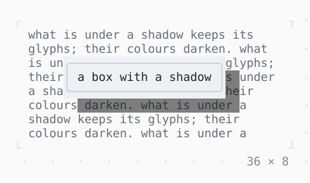

# Shadow

A drop shadow: the cells beside and below a child, moved by its offset, what is under them darkened.

| Dark | Light |
| --- | --- |
|  |  |

## Code

The Dart that builds it, as the gallery's Code tab shows it with the
options as they start:

```dart
final theme = Theme.of(context);
return SizedBox(
  width: 36,
  height: 8,
  child: Stack(
    fit: .expand,
    children: [
      Text(
        'what is under a shadow keeps its glyphs; their colours darken. ' * 5,
        style: theme.muted,
      ),
      Positioned(
        left: 5,
        top: 2,
        child: Shadow(
          shadow: const BoxShadow(),
          child: Box(
            style: theme.surface.merge(theme.text),
            border: .all(type: .rounded, style: theme.border),
            padding: const .x(1),
            child: const Text('a box with a shadow'),
          ),
        ),
      ),
    ],
  ),
);
```

## Options

What the gallery lets you change, and what each starts at:

| option | values | starts at |
| --- | --- | --- |
| offset | 2, 1, 1, 1, -2, -1 | 2, 1 |
| alpha | ¼, ½, ¾ | ½ |

## More

- API: [`Shadow`](https://pub.dev/documentation/twk/latest/twk/Shadow-class.html).
- Also in Layout: [Box](box.md), [ColoredBox, DecoratedBox](coloredbox-decoratedbox.md), [Container](container.md), [Divider](divider.md), [Padding](padding.md), [Align, Center](align-center.md), [SizedBox](sizedbox.md), [ConstrainedBox](constrainedbox.md), [LimitedBox, OverflowBox](limitedbox-overflowbox.md), [FractionallySizedBox](fractionallysizedbox.md), [IntrinsicWidth/Height](intrinsicwidth-height.md), [Row, Column, Flex](row-column-flex.md), [Expanded, Spacer](expanded-spacer.md), [Stack, Positioned](stack-positioned.md), [Transform](transform.md), [Visibility, Offstage](visibility-offstage.md), [ExpansionTile, Accordion](expansiontile-accordion.md), [Grid, GridPlacement](grid-gridplacement.md), [Wrap](wrap.md), [CustomPaint](custompaint.md), [SplitView](splitview.md), [DockArea](dockarea.md), [Scaffold](scaffold.md).
- Live in the gallery:
  `dart run packages/gallery/bin/gallery.dart --route='#/layout/shadow'`.
- [Layout](../layout.md) · [All groups](../README.md)
