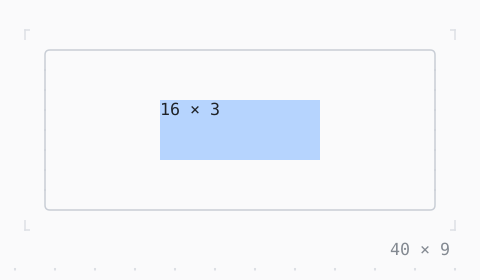

# SizedBox

A child of a size: SizedBox.expand fills the room, SizedBox.shrink takes none.

| Dark | Light |
| --- | --- |
|  |  |

## Code

The Dart that builds it, as the gallery's Code tab shows it with the
options as they start:

```dart
final theme = Theme.of(context);
return SizedBox(
  width: 40,
  height: 9,
  child: Box(
    border: .all(type: .rounded, style: theme.border),
    child: Center(
      child: SizedBox(
        width: 16,
        height: 3,
        child: Box(style: theme.selection, child: const Text('16 × 3')),
      ),
    ),
  ),
);
```

## Options

What the gallery lets you change, and what each starts at:

| option | values | starts at |
| --- | --- | --- |
| constructor | width, height, .expand, .shrink | width, height |
| width | 0 cells to 44 cells | 16 |
| height | 0 rows to 9 rows | 3 |

## More

- API: [`SizedBox`](https://pub.dev/documentation/twk/latest/twk/SizedBox-class.html).
- Also in Layout: [Box](box.md), [ColoredBox, DecoratedBox](coloredbox-decoratedbox.md), [Container](container.md), [Divider](divider.md), [Shadow](shadow.md), [Padding](padding.md), [Align, Center](align-center.md), [ConstrainedBox](constrainedbox.md), [LimitedBox, OverflowBox](limitedbox-overflowbox.md), [FractionallySizedBox](fractionallysizedbox.md), [IntrinsicWidth/Height](intrinsicwidth-height.md), [Row, Column, Flex](row-column-flex.md), [Expanded, Spacer](expanded-spacer.md), [Stack, Positioned](stack-positioned.md), [Transform](transform.md), [Visibility, Offstage](visibility-offstage.md), [ExpansionTile, Accordion](expansiontile-accordion.md), [Grid, GridPlacement](grid-gridplacement.md), [Wrap](wrap.md), [CustomPaint](custompaint.md), [SplitView](splitview.md), [DockArea](dockarea.md), [Scaffold](scaffold.md).
- Live in the gallery:
  `dart run packages/gallery/bin/gallery.dart --route='#/layout/sizedbox'`.
- [Layout](../layout.md) · [All groups](../README.md)
