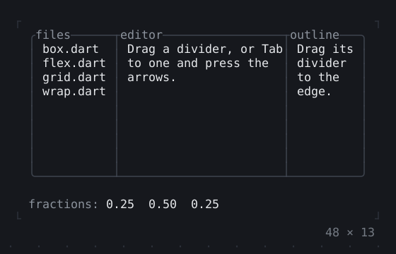
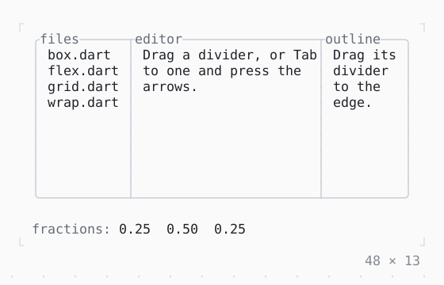

# SplitView

Panes the mouse or the arrows resize by their dividers; Tab focuses one. The last one collapses.

| Dark | Light |
| --- | --- |
|  |  |

## Code

The Dart that builds it, as the gallery's Code tab shows it with the
options as they start:

```dart
final _split = SplitController(fractions: [1, 2, 1]);

@override
void dispose() {
  _split.dispose();
  super.dispose();
}

@override
Widget build(BuildContext context) {
  final theme = Theme.of(context);
  Widget pane(String title, String text) => Box(
    border: .all(type: .rounded, style: theme.border, merge: true),
    // no blanks around the title: a divider over the edge would
    // draw its line in them
    titles: [BorderTitle(title, style: theme.muted)],
    padding: const .only(left: 1),
    child: Text(text),
  );
  return Column(
    mainAxisSize: .min,
    crossAxisAlignment: .start,
    gap: 1,
    children: [
      // as tall as the room leaves it, at most 11
      Flexible(
        child: SizedBox(
          width: 48,
          height: 11,
          child: SplitView(
            controller: _split,
            shareEdges: true,
            style: theme.border,
            panes: [
              SplitPane(
                minSize: 8,
                child: pane(
                  'files',
                  'box.dart\nflex.dart\ngrid.dart\nwrap.dart',
                ),
              ),
              SplitPane(
                minSize: 8,
                child: pane(
                  'editor',
                  'Drag a divider, or Tab to one and press the arrows.',
                ),
              ),
              SplitPane(
                minSize: 8,
                collapsible: true,
                child: pane('outline', 'Drag its divider to the edge.'),
              ),
            ],
          ),
        ),
      ),
      ListenableBuilder(
        listenable: _split,
        builder: (context, _) {
          final fractions = _split.fractions.map((f) => f.toStringAsFixed(2));
          final collapsed = _split.collapsed;
          return Text.rich([
            Span('fractions: ', theme.muted),
            Span(fractions.join('  ')),
            if (collapsed.isNotEmpty) ...[
              Span('  collapsed: ', theme.muted),
              Span('$collapsed'),
            ],
          ]);
        },
      ),
    ],
  );
}
```

## Options

What the gallery lets you change, and what each starts at:

| option | values | starts at |
| --- | --- | --- |
| direction | horizontal, vertical | horizontal |
| share edges | on, off | true |
| dividers | single, rounded, double, heavy, ascii | single |

## More

- API: [`SplitView`](https://pub.dev/documentation/twk/latest/twk/SplitView-class.html).
- Also in Layout: [Box](box.md), [ColoredBox, DecoratedBox](coloredbox-decoratedbox.md), [Container](container.md), [Divider](divider.md), [Shadow](shadow.md), [Padding](padding.md), [Align, Center](align-center.md), [SizedBox](sizedbox.md), [ConstrainedBox](constrainedbox.md), [LimitedBox, OverflowBox](limitedbox-overflowbox.md), [FractionallySizedBox](fractionallysizedbox.md), [IntrinsicWidth/Height](intrinsicwidth-height.md), [Row, Column, Flex](row-column-flex.md), [Expanded, Spacer](expanded-spacer.md), [Stack, Positioned](stack-positioned.md), [Transform](transform.md), [Visibility, Offstage](visibility-offstage.md), [ExpansionTile, Accordion](expansiontile-accordion.md), [Grid, GridPlacement](grid-gridplacement.md), [Wrap](wrap.md), [CustomPaint](custompaint.md), [DockArea](dockarea.md), [Scaffold](scaffold.md).
- Live in the gallery:
  `dart run packages/gallery/bin/gallery.dart --route='#/layout/splitview'`.
- [Layout](../layout.md) · [All groups](../README.md)
