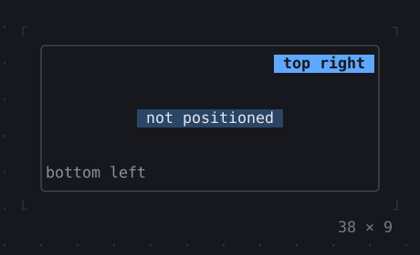
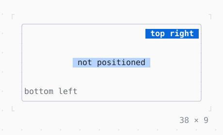

# Stack, Positioned

Children over one another, pinned to the edges or aligned.

| Dark | Light |
| --- | --- |
|  |  |

## Code

The Dart that builds it, as the gallery's Code tab shows it with the
options as they start:

```dart
final theme = Theme.of(context);
return ConstrainedBox(
  // tight across, loose down: each fit lays the child out otherwise
  constraints: const BoxConstraints(38, 38, 0, 9),
  child: Box(
    border: .all(type: .rounded, style: theme.border),
    child: Stack(
      alignment: .center,
      children: [
        // the room the others are placed in: the stack as big as it may be
        const SizedBox.expand(),
        Box(
          style: theme.selection,
          padding: const .x(1),
          child: const Text('not positioned'),
        ),
        const Positioned(right: 0, top: 0, child: Badge('top right')),
        Positioned(
          left: 0,
          bottom: 0,
          child: Text('bottom left', style: theme.muted),
        ),
      ],
    ),
  ),
);
```

## Options

What the gallery lets you change, and what each starts at:

| option | values | starts at |
| --- | --- | --- |
| alignment x | left, center, right | center |
| alignment y | top, center, bottom | center |
| fit | loose, expand, passthrough | loose |

## More

- API: [`Stack`](https://pub.dev/documentation/twk/latest/twk/Stack-class.html), [`Positioned`](https://pub.dev/documentation/twk/latest/twk/Positioned-class.html).
- Also in Layout: [Box](box.md), [ColoredBox, DecoratedBox](coloredbox-decoratedbox.md), [Container](container.md), [Divider](divider.md), [Shadow](shadow.md), [Padding](padding.md), [Align, Center](align-center.md), [SizedBox](sizedbox.md), [ConstrainedBox](constrainedbox.md), [LimitedBox, OverflowBox](limitedbox-overflowbox.md), [FractionallySizedBox](fractionallysizedbox.md), [IntrinsicWidth/Height](intrinsicwidth-height.md), [Row, Column, Flex](row-column-flex.md), [Expanded, Spacer](expanded-spacer.md), [Transform](transform.md), [Visibility, Offstage](visibility-offstage.md), [ExpansionTile, Accordion](expansiontile-accordion.md), [Grid, GridPlacement](grid-gridplacement.md), [Wrap](wrap.md), [CustomPaint](custompaint.md), [SplitView](splitview.md), [DockArea](dockarea.md), [Scaffold](scaffold.md).
- Live in the gallery:
  `dart run packages/gallery/bin/gallery.dart --route='#/layout/stack-positioned'`.
- [Layout](../layout.md) · [All groups](../README.md)
