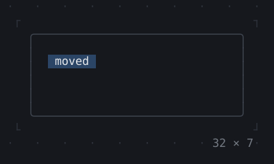
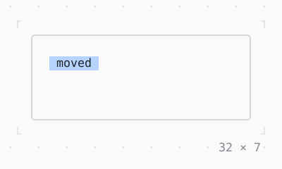

# Transform

A child shown moved by whole cells, laid out where it was: Transform.translate, the one transform a terminal has.

| Dark | Light |
| --- | --- |
|  |  |

## Code

The Dart that builds it, as the gallery's Code tab shows it with the
options as they start:

```dart
const _round = [
  (0, -2), (5, -2), (9, -1), (10, 0),
  (9, 1), (5, 2), (0, 2), (-5, 2),
  (-9, 1), (-10, 0), (-9, -1), (-5, -2),
];

var _step = 0;
late final Timer _timer;

@override
void initState() {
  super.initState();
  _timer = Timer.periodic(
    const Duration(milliseconds: 200),
    (_) => setState(() => _step++),
  );
}

@override
void dispose() {
  _timer.cancel();
  super.dispose();
}

@override
Widget build(BuildContext context) {
  final theme = Theme.of(context);
  return SizedBox(
    width: 32,
    height: 7,
    child: Box(
      border: .all(type: .rounded, style: theme.border),
      child: Transform.translate(
        offset: _round[_step % _round.length],
        child: Center(
          child: Box(
            style: theme.selection,
            padding: const .x(1),
            child: const Text('moved'),
          ),
        ),
      ),
    ),
  );
}
```

## Options

What the gallery lets you change, and what each starts at:

| option | values | starts at |
| --- | --- | --- |
| offset | round, fixed | round |
| dx | -12 cells to 12 cells | 6 |
| dy | -2 rows to 2 rows | 1 |

## More

- API: [`Transform`](https://pub.dev/documentation/twk/latest/twk/Transform-class.html).
- Also in Layout: [Box](box.md), [ColoredBox, DecoratedBox](coloredbox-decoratedbox.md), [Container](container.md), [Divider](divider.md), [Shadow](shadow.md), [Padding](padding.md), [Align, Center](align-center.md), [SizedBox](sizedbox.md), [ConstrainedBox](constrainedbox.md), [LimitedBox, OverflowBox](limitedbox-overflowbox.md), [FractionallySizedBox](fractionallysizedbox.md), [IntrinsicWidth/Height](intrinsicwidth-height.md), [Row, Column, Flex](row-column-flex.md), [Expanded, Spacer](expanded-spacer.md), [Stack, Positioned](stack-positioned.md), [Visibility, Offstage](visibility-offstage.md), [ExpansionTile, Accordion](expansiontile-accordion.md), [Grid, GridPlacement](grid-gridplacement.md), [Wrap](wrap.md), [CustomPaint](custompaint.md), [SplitView](splitview.md), [DockArea](dockarea.md), [Scaffold](scaffold.md).
- Live in the gallery:
  `dart run packages/gallery/bin/gallery.dart --route='#/layout/transform'`.
- [Layout](../layout.md) · [All groups](../README.md)
