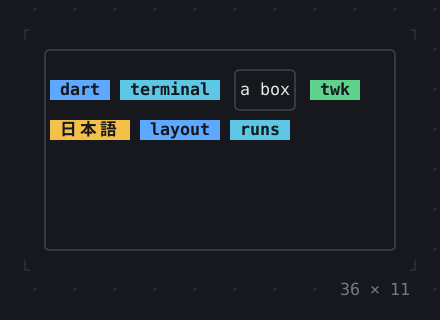
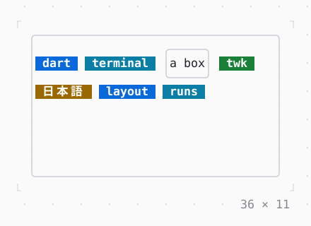

# Wrap

Children in runs that go on in the next run where they would not fit: tags, buttons and key hints on a terminal that narrows.

| Dark | Light |
| --- | --- |
|  |  |

## Code

The Dart that builds it, as the gallery's Code tab shows it with the
options as they start:

```dart
final theme = Theme.of(context);
return SizedBox(
  width: 36,
  height: 11,
  child: Box(
    border: .all(type: .rounded, style: theme.border),
    child: Wrap(
      crossAxisAlignment: .center,
      gap: 1,
      children: [
        const Badge('dart'),
        const Badge('terminal', kind: .info),
        Box(
          border: .all(type: .rounded, style: theme.border),
          child: const Text('a box'),
        ),
        const Badge('twk', kind: .success),
        const Badge('日本語', kind: .warning),
        const Badge('layout'),
        const Badge('runs', kind: .info),
      ],
    ),
  ),
);
```

## Options

What the gallery lets you change, and what each starts at:

| option | values | starts at |
| --- | --- | --- |
| width | 20 cells to 48 cells | 36 |
| narrowing | on, off | false |
| direction | horizontal, vertical | horizontal |
| alignment | start, end, center, spaceBetween, spaceAround, spaceEvenly | start |
| run alignment | start, end, center, spaceBetween, spaceAround, spaceEvenly | start |
| cross axis | start, end, center | center |
| gap | 0, 1, 2 | 1 |
| run gap | 0, 1 | 0 |

## More

- API: [`Wrap`](https://pub.dev/documentation/twk/latest/twk/Wrap-class.html).
- Also in Layout: [Box](box.md), [ColoredBox, DecoratedBox](coloredbox-decoratedbox.md), [Container](container.md), [Divider](divider.md), [Shadow](shadow.md), [Padding](padding.md), [Align, Center](align-center.md), [SizedBox](sizedbox.md), [ConstrainedBox](constrainedbox.md), [LimitedBox, OverflowBox](limitedbox-overflowbox.md), [FractionallySizedBox](fractionallysizedbox.md), [IntrinsicWidth/Height](intrinsicwidth-height.md), [Row, Column, Flex](row-column-flex.md), [Expanded, Spacer](expanded-spacer.md), [Stack, Positioned](stack-positioned.md), [Transform](transform.md), [Visibility, Offstage](visibility-offstage.md), [ExpansionTile, Accordion](expansiontile-accordion.md), [Grid, GridPlacement](grid-gridplacement.md), [CustomPaint](custompaint.md), [SplitView](splitview.md), [DockArea](dockarea.md), [Scaffold](scaffold.md).
- Live in the gallery:
  `dart run packages/gallery/bin/gallery.dart --route='#/layout/wrap'`.
- [Layout](../layout.md) · [All groups](../README.md)
