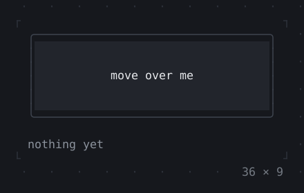
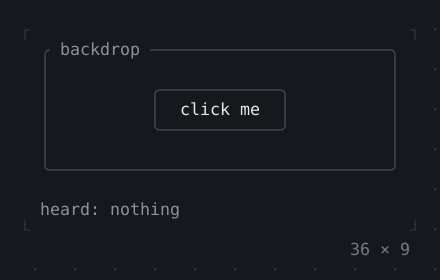
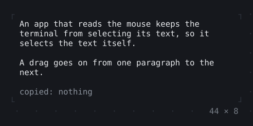
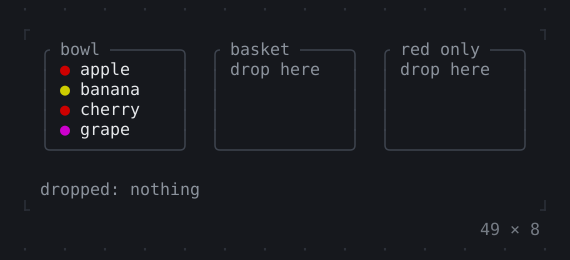

# Mouse

Clicks, drags, hovers and the wheel, and where the mouse is let through.

[All groups](README.md)

| | |
| --- | --- |
|  **[GestureDetector](mouse/gesturedetector.md)** Taps, double taps, long presses and drags of the mouse over a widget. |  **[Listener, MouseRegion](mouse/listener-mouseregion.md)** The mouse events over a widget as they come: presses, releases, motion and the wheel; the mouse coming in and going out, the pointer a hand over it where the terminal shows that. |
|  **[IgnorePointer, AbsorbPointer](mouse/ignorepointer-absorbpointer.md)** A subtree the mouse passes by: IgnorePointer lets it through to what is under it, AbsorbPointer stops it there. |  **[SelectionArea](mouse/selectionarea.md)** Text selected with the mouse as in a terminal, and copied to the clipboard: drag over it, or click twice or three times; a painted Selectable is selected in too, and a drag past its edge scrolls it. |
|  **[Draggable, DragTarget](mouse/draggable-dragtarget.md)** Data dragged from a widget with the mouse and dropped on another that accepts it. |  |

