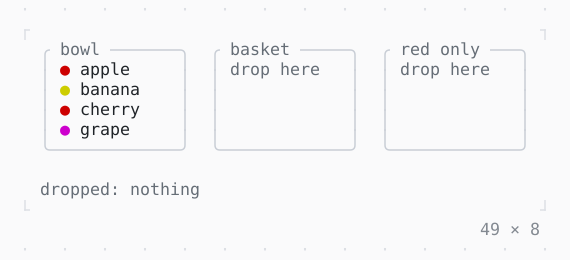

# Draggable, DragTarget

Data dragged from a widget with the mouse and dropped on another that accepts it.

| Dark | Light |
| --- | --- |
|  |  |

## Code

The Dart that builds it, as the gallery's Code tab shows it with the
options as they start:

```dart
const _red = {'apple', 'cherry'};
const _colors = {
  'apple': Color.red,
  'banana': Color.yellow,
  'cherry': Color.red,
  'grape': Color.magenta,
};

final _in = {
  'bowl': ['apple', 'banana', 'cherry', 'grape'],
  'basket': <String>[],
  'red only': <String>[],
};
String? _status;

@override
Widget build(BuildContext context) {
  final theme = Theme.of(context);
  const empty = {
    'bowl': 'empty',
    'basket': 'drop here',
    'red only': 'drop here',
  };
  return Column(
    mainAxisSize: .min,
    crossAxisAlignment: .start,
    gap: 1,
    children: [
      Row(
        mainAxisSize: .min,
        gap: 2,
        children: [
          for (final MapEntry(key: name, value: fruits) in _in.entries)
            DragTarget<String>(
              onWillAccept: (drag) =>
                  name != 'red only' || _red.contains(drag.data),
              onAccept: (drop) => setState(() {
                // dropped back on its own box, it stays where it is
                if (!fruits.contains(drop.data)) {
                  for (final list in _in.values) {
                    list.remove(drop.data);
                  }
                  fruits.add(drop.data);
                }
                _status = '${drop.data} → $name';
              }),
              builder: (context, candidate, rejected) {
                final over = candidate != null || rejected != null;
                final style = candidate != null
                    ? theme.primary
                    : rejected != null
                    ? theme.error
                    : theme.border;
                return SizedBox(
                  width: 15,
                  height: 6,
                  child: Box(
                    border: .all(type: .rounded, style: style),
                    titles: [
                      BorderTitle(
                        ' $name ',
                        style: over ? style.merge(bold) : theme.muted,
                      ),
                    ],
                    padding: const .x(1),
                    child: Column(
                      crossAxisAlignment: .start,
                      children: [
                        if (fruits.isEmpty && !over)
                          Text(empty[name]!, style: theme.muted),
                        for (final fruit in fruits)
                          _draggable(fruit, name, theme),
                        if (candidate != null && !fruits.contains(candidate))
                          Text('+ $candidate', style: theme.primary),
                        if (rejected != null)
                          Text('✗ red only', style: theme.error),
                      ],
                    ),
                  ),
                );
              },
            ),
        ],
      ),
      Text.rich([
        Span('dropped: ', theme.muted),
        Span(
          _status ?? 'nothing',
          _status == null ? theme.muted : const Style(),
        ),
      ]),
    ],
  );
}

/// [fruit] in the box [from], dragged with the mouse: the pointer a
/// hand over it, a closed one while it is dragged, no-drop over a box
/// that refuses it (Draggable's pointerShapes).
Widget _draggable(String fruit, String from, ThemeData theme) {
  Widget label([Style style = const Style()]) =>
      Text.rich(['● '.fg(_colors[fruit]!), Span(fruit)], style: style);
  return Draggable<String>(
    data: fruit,
    // what follows the mouse: a chip on the surface, with a shadow
    feedback: Shadow(
      shadow: const BoxShadow(dx: 1),
      child: Box(
        style: theme.surface,
        padding: const .x(1),
        child: label(theme.text.merge(bold)),
      ),
    ),
    childWhenDragging: Text('● $fruit', style: theme.muted),
    onDragCanceled: () => setState(() => _status = '$fruit, back to the $from'),
    child: label(),
  );
}

const bold = Style(attrs: Attr.bold);
```

## Options

What the gallery lets you change, and what each starts at:

| option | values | starts at |
| --- | --- | --- |
| child when dragging | on, off | true |

## More

- API: [`Draggable`](https://pub.dev/documentation/twk/latest/twk/Draggable-class.html), [`DragTarget`](https://pub.dev/documentation/twk/latest/twk/DragTarget-class.html).
- Also in Mouse: [GestureDetector](gesturedetector.md), [Listener, MouseRegion](listener-mouseregion.md), [IgnorePointer, AbsorbPointer](ignorepointer-absorbpointer.md), [SelectionArea](selectionarea.md).
- Live in the gallery:
  `dart run packages/gallery/bin/gallery.dart --route='#/mouse/draggable-dragtarget'`.
- [Mouse](../mouse.md) · [All groups](../README.md)
