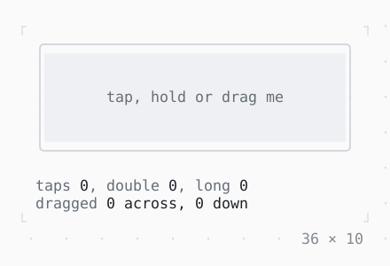

# GestureDetector

Taps, double taps, long presses and drags of the mouse over a widget.

| Dark | Light |
| --- | --- |
|  |  |

## Code

The Dart that builds it, as the gallery's Code tab shows it with the
options as they start:

```dart
var _taps = 0, _doubleTaps = 0, _longPresses = 0;
var _dragged = (0, 0);
String? _last;
(int, int)? _from, _at; // the drag: where it started, where it is

void _saw(String what, PointerEvent event) =>
    _last = '$what at ${event.x}, ${event.y}';

@override
Widget build(BuildContext context) {
  final theme = Theme.of(context);
  return Column(
    mainAxisSize: .min,
    crossAxisAlignment: .start,
    gap: 1,
    children: [
      GestureDetector(
        onTap: (event) => setState(() {
          _taps++;
          _saw('tap', event);
        }),
        onDoubleTap: (event) => setState(() {
          _doubleTaps++;
          _saw('double tap', event);
        }),
        onLongPress: (event) => setState(() {
          _longPresses++;
          _saw('long press', event);
        }),
        onDragStart: (drag) => setState(() => _from = (drag.x, drag.y)),
        onDragUpdate: (drag) => setState(() {
          _dragged = (_dragged.$1 + drag.dx, _dragged.$2 + drag.dy);
          _at = (drag.x, drag.y);
          _saw('drag', drag.event);
        }),
        onDragEnd: (drag) => setState(() {
          _from = _at = null;
          _saw('drag ended', drag.event);
        }),
        child: SizedBox(
          width: 36,
          height: 7,
          child: Box(
            border: .all(type: .rounded, style: theme.border),
            child: Box(
              style: theme.surface,
              child: Stack(
                children: [
                  Center(
                    child: Text(
                      _last ?? 'tap, hold or drag me',
                      style: _last == null ? theme.muted : const Style(),
                    ),
                  ),
                  // the detector's cells, less the border
                  if (_from case (final x, final y))
                    Positioned(
                      left: x - 1,
                      top: y - 1,
                      child: Text('○', style: theme.muted),
                    ),
                  if (_at case (final x, final y))
                    Positioned(
                      left: x - 1,
                      top: y - 1,
                      child: Text('●', style: theme.primary),
                    ),
                ],
              ),
            ),
          ),
        ),
      ),
      Column(
        mainAxisSize: .min,
        crossAxisAlignment: .start,
        children: [
          Text.rich([
            Span('taps ', theme.muted),
            Span('$_taps'),
            Span(', double ', theme.muted),
            Span('$_doubleTaps'),
            Span(', long ', theme.muted),
            Span('$_longPresses'),
          ]),
          Text.rich([
            Span('dragged ', theme.muted),
            Span('${_dragged.$1} across, ${_dragged.$2} down'),
          ]),
        ],
      ),
    ],
  );
}
```

## Options

What the gallery lets you change, and what each starts at:

| option | values | starts at |
| --- | --- | --- |
| double tap | on, off | true |
| long press after | 500 ms, 1 s | 500 ms |
| buttons | left, right, left, middle, right | left |

## More

- API: [`GestureDetector`](https://pub.dev/documentation/twk/latest/twk/GestureDetector-class.html).
- Also in Mouse: [Listener, MouseRegion](listener-mouseregion.md), [IgnorePointer, AbsorbPointer](ignorepointer-absorbpointer.md), [SelectionArea](selectionarea.md), [Draggable, DragTarget](draggable-dragtarget.md).
- Live in the gallery:
  `dart run packages/gallery/bin/gallery.dart --route='#/mouse/gesturedetector'`.
- [Mouse](../mouse.md) · [All groups](../README.md)
