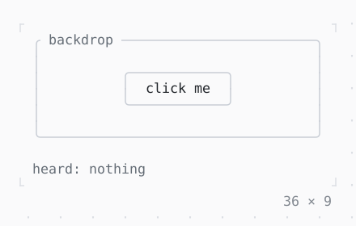

# IgnorePointer, AbsorbPointer

A subtree the mouse passes by: IgnorePointer lets it through to what is under it, AbsorbPointer stops it there.

| Dark | Light |
| --- | --- |
|  |  |

## Code

The Dart that builds it, as the gallery's Code tab shows it with the
options as they start:

```dart
var _over = false;
var _heard = '';

@override
Widget build(BuildContext context) {
  final theme = Theme.of(context);
  return Column(
    mainAxisSize: .min,
    crossAxisAlignment: .start,
    gap: 1,
    children: [
      Stack(
        children: [
          GestureDetector(
            onTap: (_) => setState(() => _heard = 'the backdrop'),
            behavior: .opaque,
            child: SizedBox(
              width: 36,
              height: 7,
              child: Box(
                border: .all(type: .rounded, style: theme.border),
                titles: [BorderTitle(' backdrop ', style: theme.muted)],
              ),
            ),
          ),
          Positioned.fill(
            child: Center(
              child: IgnorePointer(
                child: MouseRegion(
                  onEnter: (_) => setState(() => _over = true),
                  onExit: (_) => setState(() => _over = false),
                  child: GestureDetector(
                    onTap: (_) => setState(() => _heard = 'the button'),
                    child: Box(
                      border: .all(
                        type: .rounded,
                        style: _over ? theme.primary : theme.border,
                      ),
                      padding: const .x(2),
                      child: const Text('click me'),
                    ),
                  ),
                ),
              ),
            ),
          ),
        ],
      ),
      Text.rich([
        Span('heard: ', theme.muted),
        if (_heard.isEmpty) Span('nothing', theme.muted) else Span(_heard),
      ]),
    ],
  );
}
```

## Options

What the gallery lets you change, and what each starts at:

| option | values | starts at |
| --- | --- | --- |
| around the button | none, IgnorePointer, AbsorbPointer | IgnorePointer |

## More

- API: [`IgnorePointer`](https://pub.dev/documentation/twk/latest/twk/IgnorePointer-class.html), [`AbsorbPointer`](https://pub.dev/documentation/twk/latest/twk/AbsorbPointer-class.html).
- Also in Mouse: [GestureDetector](gesturedetector.md), [Listener, MouseRegion](listener-mouseregion.md), [SelectionArea](selectionarea.md), [Draggable, DragTarget](draggable-dragtarget.md).
- Live in the gallery:
  `dart run packages/gallery/bin/gallery.dart --route='#/mouse/ignorepointer-absorbpointer'`.
- [Mouse](../mouse.md) · [All groups](../README.md)
