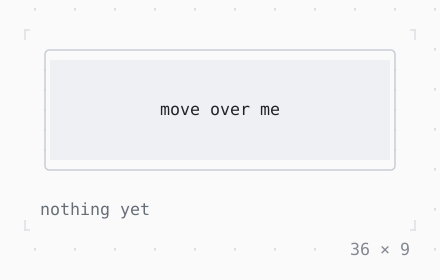

# Listener, MouseRegion

The mouse events over a widget as they come: presses, releases, motion and the wheel; the mouse coming in and going out, the pointer a hand over it where the terminal shows that.

| Dark | Light |
| --- | --- |
|  |  |

## Code

The Dart that builds it, as the gallery's Code tab shows it with the
options as they start:

```dart
var _over = false;
final _events = <String>[];

// what came, the newest first
void _saw(String what, PointerEvent event) => setState(() {
  _events.insert(0, '$what at ${event.x}, ${event.y}');
  if (_events.length > 4) _events.removeLast();
});

@override
Widget build(BuildContext context) {
  final theme = Theme.of(context);
  return Column(
    mainAxisSize: .min,
    crossAxisAlignment: .start,
    gap: 1,
    children: [
      MouseRegion(
        onEnter: (event) {
          _over = true;
          _saw('enter', event);
        },
        onExit: (event) {
          _over = false;
          _saw('exit', event);
        },
        cursor: .pointer,
        child: Listener(
          onDown: (event) => _saw('press of button ${event.button}', event),
          onUp: (event) => _saw('release', event),
          onMove: (event) => _saw('move', event),
          onDrag: (event) => _saw('drag', event),
          onScroll: (event) => _saw(event.kind.name, event),
          behavior: .opaque,
          child: SizedBox(
            width: 36,
            height: 7,
            child: Box(
              border: .all(
                type: .rounded,
                style: _over ? theme.primary : theme.border,
              ),
              child: Box(
                style: _over ? theme.selection : theme.surface,
                child: Center(
                  child: Text(_over ? 'the mouse is over me' : 'move over me'),
                ),
              ),
            ),
          ),
        ),
      ),
      Column(
        mainAxisSize: .min,
        crossAxisAlignment: .start,
        children: [
          if (_events.isEmpty) Text('nothing yet', style: theme.muted),
          for (final (i, event) in _events.indexed)
            Text(event, style: i == 0 ? const Style() : theme.muted),
        ],
      ),
    ],
  );
}
```

## Options

What the gallery lets you change, and what each starts at:

| option | values | starts at |
| --- | --- | --- |
| cursor | pointer, crosshair, text, grab, move, notAllowed, wait, none | pointer |

## More

- API: [`Listener`](https://pub.dev/documentation/twk/latest/twk/Listener-class.html), [`MouseRegion`](https://pub.dev/documentation/twk/latest/twk/MouseRegion-class.html).
- Also in Mouse: [GestureDetector](gesturedetector.md), [IgnorePointer, AbsorbPointer](ignorepointer-absorbpointer.md), [SelectionArea](selectionarea.md), [Draggable, DragTarget](draggable-dragtarget.md).
- Live in the gallery:
  `dart run packages/gallery/bin/gallery.dart --route='#/mouse/listener-mouseregion'`.
- [Mouse](../mouse.md) · [All groups](../README.md)
