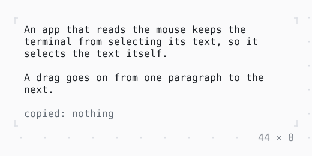

# SelectionArea

Text selected with the mouse as in a terminal, and copied to the clipboard: drag over it, or click twice or three times; a painted Selectable is selected in too, and a drag past its edge scrolls it.

| Dark | Light |
| --- | --- |
|  |  |

## Code

The Dart that builds it, as the gallery's Code tab shows it with the
options as they start:

```dart
var _copied = '';

@override
Widget build(BuildContext context) {
  final theme = Theme.of(context);
  return SizedBox(
    width: 44,
    child: Column(
      mainAxisSize: .min,
      crossAxisAlignment: .start,
      gap: 1,
      children: [
        SelectionArea(
          onCopy: (text) => setState(() => _copied = text),
          child: const Column(
            mainAxisSize: .min,
            crossAxisAlignment: .start,
            gap: 1,
            children: [
              Text(
                'An app that reads the mouse keeps the terminal from '
                'selecting its text, so it selects the text itself.',
              ),
              Text('A drag goes on from one paragraph to the next.'),
            ],
          ),
        ),
        // what was copied, in the width the label leaves
        Row(
          crossAxisAlignment: .start,
          gap: 1,
          children: [
            Text('copied:', style: theme.muted),
            Expanded(
              child: Text(
                _copied.isEmpty ? 'nothing' : _copied.replaceAll('\n', ' '),
                style: _copied.isEmpty ? theme.muted : const Style(),
                maxLines: 2,
                overflow: .ellipsis,
              ),
            ),
          ],
        ),
      ],
    ),
  );
}
```

## Options

What the gallery lets you change, and what each starts at:

| option | values | starts at |
| --- | --- | --- |
| selected in | two Texts, a painted log | two Texts |
| copy on release | on, off | true |
| style | the theme's, reverse | the theme's |

## More

- API: [`SelectionArea`](https://pub.dev/documentation/twk/latest/twk/SelectionArea-class.html).
- Also in Mouse: [GestureDetector](gesturedetector.md), [Listener, MouseRegion](listener-mouseregion.md), [IgnorePointer, AbsorbPointer](ignorepointer-absorbpointer.md), [Draggable, DragTarget](draggable-dragtarget.md).
- Live in the gallery:
  `dart run packages/gallery/bin/gallery.dart --route='#/mouse/selectionarea'`.
- [Mouse](../mouse.md) · [All groups](../README.md)
