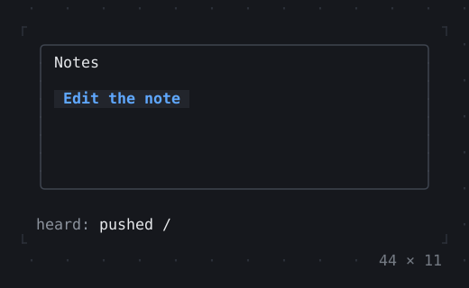
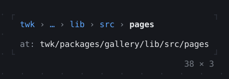

# Navigation

Routes, a scaffold of panes, steppers, breadcrumbs and pages.

[All groups](README.md)

| | |
| --- | --- |
|  **[Navigator](navigation/navigator.md)** Screens on a stack: a route pushed covers the one under it and takes the focus, Escape or Back pops it. |  **[PopScope, NavigatorObserver](navigation/popscope-navigatorobserver.md)** A route that asks before it is popped, by Escape or by the back key, a dialog too; and an observer told of every push, pop and removal. |
|  **[Breadcrumbs](navigation/breadcrumbs.md)** Where a screen is in a hierarchy, each level a link up: the arrows and Enter or a click go to one, and the middle collapses into … where the row does not fit. |  **[Pagination](navigation/pagination.md)** The pages of a long list on one row, the current one among its siblings: the arrows, PageUp and PageDown, a page number typed or a click go to another. |
|  **[Stepper](navigation/stepper.md)** A wizard of steps under their headers, each left forward once its validation takes it: Next or PageDown validates, Back or PageUp goes back, a header clicked goes to it. |  |

