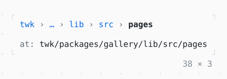

# Breadcrumbs

Where a screen is in a hierarchy, each level a link up: the arrows and Enter or a click go to one, and the middle collapses into … where the row does not fit.

| Dark | Light |
| --- | --- |
|  |  |

## Code

The Dart that builds it, as the gallery's Code tab shows it with the
options as they start:

```dart
static const _path = ['twk', 'packages', 'gallery', 'lib', 'src', 'pages'];
var _at = _path.length - 1;

@override
Widget build(BuildContext context) => Column(
  mainAxisSize: .min,
  crossAxisAlignment: .start,
  gap: 1,
  children: [
    SizedBox(
      width: 36,
      child: Breadcrumbs(
        items: _path,
        current: _at,
        onSelected: (index) => setState(() => _at = index),
      ),
    ),
    Text.rich([
      Span('at: ', Theme.of(context).muted),
      Span(_path.take(_at + 1).join('/')),
    ]),
  ],
);
```

## Options

What the gallery lets you change, and what each starts at:

| option | values | starts at |
| --- | --- | --- |
| width | 12 cells to 50 cells | 36 |
| leading kept | 1, 0, 2 | 1 |
| separator | ›, / | › |

## More

- API: [`Breadcrumbs`](https://pub.dev/documentation/twk/latest/twk/Breadcrumbs-class.html).
- Also in Navigation: [Navigator](navigator.md), [PopScope, NavigatorObserver](popscope-navigatorobserver.md), [Pagination](pagination.md), [Stepper](stepper.md).
- Live in the gallery:
  `dart run packages/gallery/bin/gallery.dart --route='#/navigation/breadcrumbs'`.
- [Navigation](../navigation.md) · [All groups](../README.md)
