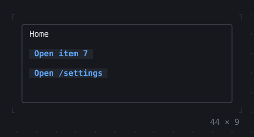
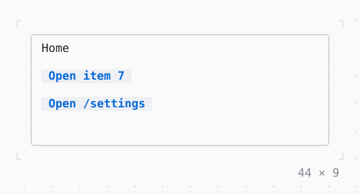

# Navigator

Screens on a stack: a route pushed covers the one under it and takes the focus, Escape or Back pops it.

| Dark | Light |
| --- | --- |
|  |  |

## Code

The Dart that builds it, as the gallery's Code tab shows it with the
options as they start:

```dart
@override
Widget build(BuildContext context) => SizedBox(
  width: 44,
  height: 9,
  child: Box(
    border: .all(type: .rounded, style: Theme.of(context).border),
    padding: const .x(1),
    child: Navigator(
      home: const _Home(),
      onGenerateRoute: (settings) => settings.name == '/settings'
          ? _Slide.route((_) => const _Settings(), settings)
          : null,
    ),
  ),
);

/// The routes of the screens: each slides in from the right over the one
/// under it, which dims, and out again as it is popped.
abstract final class _Slide {
  static PageRoute<void> route(
    Widget Function(BuildContext context) builder, [
    RouteSettings settings = const RouteSettings(),
  ]) => PageRoute(
    builder: builder,
    settings: settings,
    transitionDuration: const Duration(milliseconds: 220),
    reverseTransitionDuration: const Duration(milliseconds: 180),
  );
}

/// The first route: buttons that push the others.
final class _Home extends StatelessWidget {
  const _Home();

  @override
  Widget build(BuildContext context) => Column(
    crossAxisAlignment: .start,
    gap: 1,
    children: [
      const Text('Home'),
      Button(
        'Open item 7',
        onPressed: () =>
            Navigator.push(context, _Slide.route((_) => const _Item(7))),
      ),
      Button(
        'Open /settings',
        onPressed: () => Navigator.pushNamed<void>(context, '/settings'),
      ),
    ],
  );
}

/// Item [n], with a button that pops it and one that pushes the next.
final class _Item extends StatelessWidget {
  const _Item(this.n);

  final int n;

  @override
  Widget build(BuildContext context) => Column(
    crossAxisAlignment: .start,
    gap: 1,
    children: [
      Text('Item $n', style: Theme.of(context).primary),
      Row(
        gap: 2,
        children: [
          Button(
            'Back',
            autofocus: true,
            onPressed: () => Navigator.pop(context),
          ),
          Button(
            'Open item ${n + 1}',
            onPressed: () =>
                Navigator.push(context, _Slide.route((_) => _Item(n + 1))),
          ),
        ],
      ),
    ],
  );
}

/// The route named /settings, with a button that pops it.
final class _Settings extends StatelessWidget {
  const _Settings();

  @override
  Widget build(BuildContext context) => Column(
    crossAxisAlignment: .start,
    gap: 1,
    children: [
      Text('Settings', style: Theme.of(context).primary),
      Button(
        'Back',
        autofocus: true,
        onPressed: () => Navigator.pop(context),
      ),
    ],
  );
}
```

## Options

What the gallery lets you change, and what each starts at:

| option | values | starts at |
| --- | --- | --- |
| back key | escape, backspace, none | escape |

## More

- API: [`Navigator`](https://pub.dev/documentation/twk/latest/twk/Navigator-class.html).
- Also in Navigation: [PopScope, NavigatorObserver](popscope-navigatorobserver.md), [Breadcrumbs](breadcrumbs.md), [Pagination](pagination.md), [Stepper](stepper.md).
- Live in the gallery:
  `dart run packages/gallery/bin/gallery.dart --route='#/navigation/navigator'`.
- [Navigation](../navigation.md) · [All groups](../README.md)
