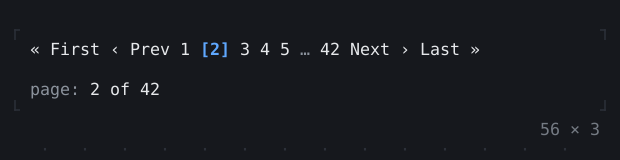
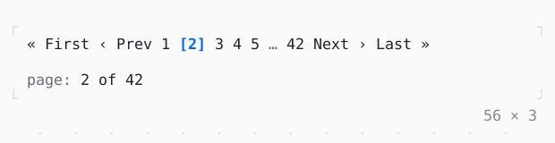

# Pagination

The pages of a long list on one row, the current one among its siblings: the arrows, PageUp and PageDown, a page number typed or a click go to another.

| Dark | Light |
| --- | --- |
|  |  |

## Code

The Dart that builds it, as the gallery's Code tab shows it with the
options as they start:

```dart
var _page = 1;

@override
Widget build(BuildContext context) {
  final theme = Theme.of(context);
  return Column(
    mainAxisSize: .min,
    crossAxisAlignment: .start,
    gap: 1,
    children: [
      SizedBox(
        width: 56,
        child: Pagination(
          page: _page,
          pageCount: 42,
          onChanged: (page) => setState(() => _page = page),
        ),
      ),
      Text.rich([
        Span('page: ', theme.muted),
        Span('${_page + 1} of 42'),
      ]),
    ],
  );
}
```

## Options

What the gallery lets you change, and what each starts at:

| option | values | starts at |
| --- | --- | --- |
| width | 16 cells to 56 cells | 56 |
| siblings | 1, 0, 2 | 1 |
| first and last | on, off | true |
| previous and next | on, off | true |
| range | on, off | false |

## More

- API: [`Pagination`](https://pub.dev/documentation/twk/latest/twk/Pagination-class.html).
- Also in Navigation: [Navigator](navigator.md), [PopScope, NavigatorObserver](popscope-navigatorobserver.md), [Breadcrumbs](breadcrumbs.md), [Stepper](stepper.md).
- Live in the gallery:
  `dart run packages/gallery/bin/gallery.dart --route='#/navigation/pagination'`.
- [Navigation](../navigation.md) · [All groups](../README.md)
