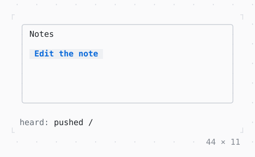

# PopScope, NavigatorObserver

A route that asks before it is popped, by Escape or by the back key, a dialog too; and an observer told of every push, pop and removal.

| Dark | Light |
| --- | --- |
|  |  |

## Code

The Dart that builds it, as the gallery's Code tab shows it with the
options as they start:

```dart
final _heard = _Heard();

@override
void dispose() {
  _heard.dispose();
  super.dispose();
}

@override
Widget build(BuildContext context) => Column(
  mainAxisSize: .min,
  crossAxisAlignment: .start,
  gap: 1,
  children: [
    SizedBox(
      width: 44,
      height: 9,
      child: Box(
        border: .all(type: .rounded, style: Theme.of(context).border),
        padding: const .x(1),
        child: Navigator(
          observers: [_heard],
          home: const _Notes(),
          routes: {'/edit': (_) => const _Edit()},
        ),
      ),
    ),
    ListenableBuilder(
      listenable: _heard,
      builder: (context, _) => Text.rich([
        Span('heard: ', Theme.of(context).muted),
        Span(_heard.last),
      ]),
    ),
  ],
);

/// Hears of each route pushed, popped and removed, the last of them
/// [last].
final class _Heard extends NavigatorObserver with ChangeNotifier {
  var last = '';

  String _name(Route<Object?> route) => route.settings.name ?? 'a dialog';

  @override
  void didPush(Route<Object?> route, Route<Object?>? previousRoute) {
    last = 'pushed ${_name(route)}';
    notifyListeners();
  }

  @override
  void didPop(Route<Object?> route, Route<Object?>? previousRoute) {
    last = 'popped ${_name(route)}';
    notifyListeners();
  }

  // a dialog closeDialog closes
  @override
  void didRemove(Route<Object?> route, Route<Object?>? previousRoute) {
    last = 'removed ${_name(route)}';
    notifyListeners();
  }
}

/// The first route: a button that pushes the editor.
final class _Notes extends StatelessWidget {
  const _Notes();

  @override
  Widget build(BuildContext context) => Column(
    crossAxisAlignment: .start,
    gap: 1,
    children: [
      const Text('Notes'),
      Button(
        'Edit the note',
        onPressed: () => Navigator.pushNamed<void>(context, '/edit'),
      ),
    ],
  );
}

/// The note's editor: Back pops it, asking first while it is changed.
final class _Edit extends StatefulWidget {
  const _Edit();

  @override
  State<_Edit> createState() => _EditState();
}

final class _EditState extends State<_Edit> {
  var _changed = false;

  Future<void> _ask() async {
    final discard = await showDialog<bool>(
      context,
      (context) => Dialog(
        title: 'Discard the changes?',
        child: Column(
          mainAxisSize: .min,
          crossAxisAlignment: .start,
          gap: 1,
          children: [
            const Text('The note was changed.'),
            Row(
              mainAxisSize: .min,
              gap: 2,
              children: [
                Button(
                  'Discard',
                  autofocus: true,
                  onPressed: () => closeDialog(context, true),
                ),
                Button('Keep', onPressed: () => closeDialog(context, false)),
              ],
            ),
          ],
        ),
      ),
    );
    if ((discard ?? false) && mounted) {
      Navigator.pop(context);
    }
  }

  @override
  Widget build(BuildContext context) => PopScope<void>(
    canPop: !_changed,
    // a pop it kept: Back or the back key while the note is changed
    onPopInvokedWithResult: (didPop, _) {
      if (!didPop) {
        unawaited(_ask());
      }
    },
    child: Column(
      crossAxisAlignment: .start,
      gap: 1,
      children: [
        Text('Edit the note', style: Theme.of(context).primary),
        Checkbox(
          value: _changed,
          label: 'changed',
          onChanged: (v) => setState(() => _changed = v),
        ),
        Button(
          'Back',
          autofocus: true,
          onPressed: () => Navigator.maybePop(context),
        ),
      ],
    ),
  );
}
```

## Options

What the gallery lets you change, and what each starts at:

| option | values | starts at |
| --- | --- | --- |
| PopScope | on, off | true |
| esc in the dialog | closes it, is kept | closes it |

## More

- API: [`PopScope`](https://pub.dev/documentation/twk/latest/twk/PopScope-class.html), [`NavigatorObserver`](https://pub.dev/documentation/twk/latest/twk/NavigatorObserver-class.html).
- Also in Navigation: [Navigator](navigator.md), [Breadcrumbs](breadcrumbs.md), [Pagination](pagination.md), [Stepper](stepper.md).
- Live in the gallery:
  `dart run packages/gallery/bin/gallery.dart --route='#/navigation/popscope-navigatorobserver'`.
- [Navigation](../navigation.md) · [All groups](../README.md)
