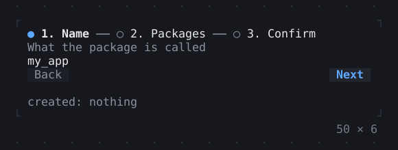
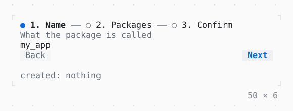

# Stepper

A wizard of steps under their headers, each left forward once its validation takes it: Next or PageDown validates, Back or PageUp goes back, a header clicked goes to it.

| Dark | Light |
| --- | --- |
|  |  |

## Code

The Dart that builds it, as the gallery's Code tab shows it with the
options as they start:

```dart
final _name = TextEditingController(text: 'my_app');
final _packages = {'args'};
var _created = '';

@override
void dispose() {
  _name.dispose();
  super.dispose();
}

Widget _package(String name) => Checkbox(
  value: _packages.contains(name),
  label: name,
  onChanged: (on) => setState(() {
    if (!on) {
      _packages.remove(name);
    } else {
      _packages.add(name);
    }
  }),
);

@override
Widget build(BuildContext context) {
  final theme = Theme.of(context);
  return Column(
    mainAxisSize: .min,
    crossAxisAlignment: .start,
    gap: 1,
    children: [
      SizedBox(
        width: 50,
        child: Stepper(
          steps: [
            Step(
              title: 'Name',
              subtitle: 'What the package is called',
              content: TextField(
                controller: _name,
                semanticsLabel: 'Name',
              ),
              validate: () =>
                  _name.text.isEmpty ? 'The package needs a name' : null,
            ),
            Step(
              title: 'Packages',
              subtitle: 'What it depends on',
              content: Column(
                mainAxisSize: .min,
                crossAxisAlignment: .start,
                children: [
                  _package('args'),
                  _package('http'),
                  _package('path'),
                ],
              ),
              // as a server that looks them up would
              validate: () async {
                await Future<void>.delayed(
                  const Duration(milliseconds: 800),
                );
                return _packages.isEmpty ? 'Pick one at least' : null;
              },
            ),
            Step(
              title: 'Confirm',
              content: Text(
                'Create ${_name.text} with ${_packages.join(', ')}?',
              ),
            ),
          ],
          onFinished: () => setState(() => _created = _name.text),
        ),
      ),
      Text.rich([
        Span('created: ', theme.muted),
        if (_created.isEmpty)
          Span('nothing', theme.muted)
        else
          Span(_created),
      ]),
    ],
  );
}
```

## Options

What the gallery lets you change, and what each starts at:

| option | values | starts at |
| --- | --- | --- |
| direction | horizontal, vertical | horizontal |
| linear | on, off | true |
| back and next | on, off | true |
| packages disabled | on, off | false |

## More

- API: [`Stepper`](https://pub.dev/documentation/twk/latest/twk/Stepper-class.html).
- Also in Navigation: [Navigator](navigator.md), [PopScope, NavigatorObserver](popscope-navigatorobserver.md), [Breadcrumbs](breadcrumbs.md), [Pagination](pagination.md).
- Live in the gallery:
  `dart run packages/gallery/bin/gallery.dart --route='#/navigation/stepper'`.
- [Navigation](../navigation.md) · [All groups](../README.md)
