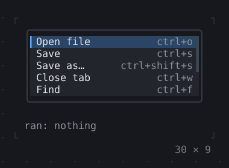

# Overlays

Dialogs, toasts, tooltips, popovers, menus and the command palette, over the app.

[All groups](README.md)

| | |
| --- | --- |
|  **[Overlay](overlays/overlay.md)** A layer over the app that dialogs, toasts, menus and tooltips go in; an entry of its own goes in it too. |  **[Dialog](overlays/dialog.md)** A box over the app, the rest dimmed behind a barrier; Tab stays in it, Escape closes it. |
|  **[Toast](overlays/toast.md)** A message that shows for a while and goes, over a corner of the app. |  **[Tooltip](overlays/tooltip.md)** A message by a widget while the mouse or the keyboard focus rests on it, or while the app shows it. |
|  **[Popover](overlays/popover.md)** A widget by another while the app says so; Escape or a click outside closes it. |  **[MenuBar](overlays/menubar.md)** Menus in a bar: F10 or a click opens one, Alt and a mnemonic too, or a MenuController from the app; the arrows, Enter and the mnemonics choose. |
|  **[ContextMenu](overlays/contextmenu.md)** A menu at the mouse on a right click, under the focus on Shift+F10, or where a MenuController opens it. |  **[CommandPalette](overlays/commandpalette.md)** What can be done, found by typing: Ctrl+K on a button, or a CommandPaletteController opening it with a query; commandsFor adds more. The gallery's own, Ctrl+P, goes to a page. |
|  **[OptionList](overlays/optionlist.md)** Options in rows, one highlighted, the characters a query matched standing out and a detail at the right edge: what an autocomplete, a Select and a command palette list. |  **[ModalBarrier](overlays/modalbarrier.md)** What dims the app under a dialog and keeps the mouse from it. |
|  **[WindowLayer](overlays/windowlayer.md)** Windows over the app: a title bar drags one, an edge resizes it, its buttons minimise, maximise and close it; Tab to a title bar, then the arrows move it. |  |

