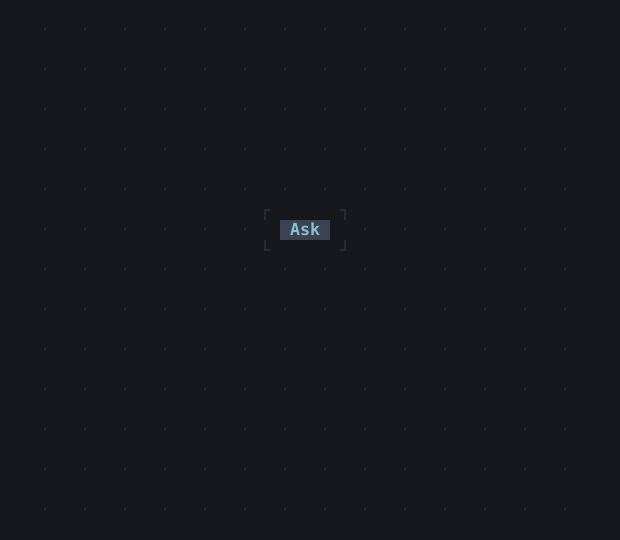
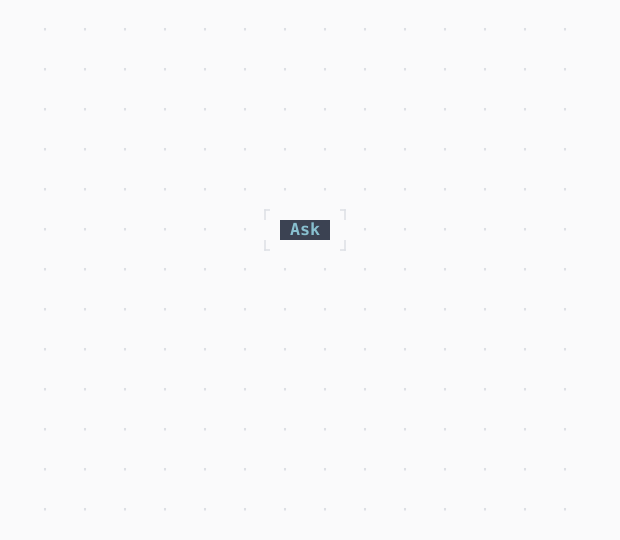

# App

The root of an app: its theme over the Overlay its dialogs show in, over the app and its own keys.

| Dark | Light |
| --- | --- |
|  |  |

## Code

The Dart that builds it, as the gallery's Code tab shows it with the
options as they start:

```dart
@override
Widget build(BuildContext context) => App(
  theme: ThemeData.nord,
  // a context below the App: its Overlay is the one the dialog shows in
  child: Builder(
    builder: (context) => Button(
      'Ask',
      onPressed: () => unawaited(
        showDialog<void>(
          context,
          (context) => Dialog(
            title: 'In the theme',
            child: Button(
              'OK',
              autofocus: true,
              onPressed: () => closeDialog(context),
            ),
          ),
        ),
      ),
    ),
  ),
);
```

## Options

What the gallery lets you change, and what each starts at:

| option | values | starts at |
| --- | --- | --- |
| theme | nord, light, dark | nord |

## More

- API: [`App`](https://pub.dev/documentation/twk/latest/twk/App-class.html).
- Also in Overlays: [Overlay](overlay.md), [Dialog](dialog.md), [Toast](toast.md), [Tooltip](tooltip.md), [Popover](popover.md), [MenuBar](menubar.md), [ContextMenu](contextmenu.md), [CommandPalette](commandpalette.md), [OptionList](optionlist.md), [ModalBarrier](modalbarrier.md), [WindowLayer](windowlayer.md).
- Live in the gallery:
  `dart run packages/gallery/bin/gallery.dart --route='#/overlays/app'`.
- [Overlays](../overlays.md) · [All groups](../README.md)
