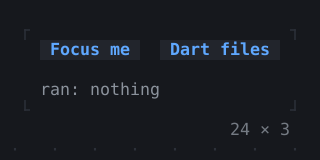
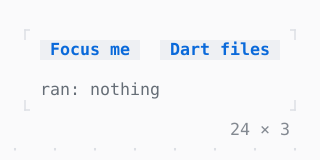

# CommandPalette

What can be done, found by typing: Tab to a button, then Ctrl+K, or press Dart files, whose CommandPaletteController opens it with dart typed; commandsFor adds the files that match. The gallery's own, Ctrl+P, goes to a page.

| Dark | Light |
| --- | --- |
|  |  |

## Code

The Dart that builds it, as the gallery's Code tab shows it with the
options as they start:

```dart
final _palette = CommandPaletteController();
String? _ran;

@override
void dispose() {
  _palette.dispose();
  super.dispose();
}

void _run(String what) => setState(() => _ran = what);
void _build() => _run('Build');
void _test() => _run('Run tests');
void _save() => _run('Save');

// the files whose path matches what is typed, none while nothing is
Iterable<Command> _files(String query) => [
  if (query.isNotEmpty)
    for (final file in const [
      'lib/main.dart',
      'lib/src/app.dart',
      'lib/src/theme.dart',
      'test/app_test.dart',
      'README.md',
      'pubspec.yaml',
    ])
      if (fuzzyMatch(query, file) != null)
        Command(file, onSelected: () => _run('open $file')),
];

@override
Widget build(BuildContext context) => CommandPalette(
  controller: _palette,
  openKey: 'ctrl+k',
  width: 40,
  commands: [
    Command('Build', onSelected: _build),
    Command('Run tests', onSelected: _test),
    Command('Format', onSelected: () => _run('Format')),
    Command('Deploy', onSelected: () => _run('Deploy')),
  ],
  // listed after the commands that match
  commandsFor: _files,
  // listed after the commands: the keys bound with a hint where the
  // focus is, the Button's Enter (press) and Ctrl+S (Save); by each the
  // key bound to what it calls
  child: KeyBindings(
    {'ctrl+b': _build, 'f8': _test, 'ctrl+s': _save},
    hints: {'ctrl+s': 'Save'},
    child: Column(
      mainAxisSize: .min,
      crossAxisAlignment: .start,
      gap: 1,
      children: [
        Row(
          mainAxisSize: .min,
          gap: 2,
          children: [
            Button('Focus me', onPressed: () => _run('press')),
            // opens the palette with dart typed
            Button(
              'Dart files',
              onPressed: () => _palette.open(query: 'dart'),
            ),
          ],
        ),
        Text.rich([
          Span('ran: ', Theme.of(context).muted),
          switch (_ran) {
            null => Span('nothing', Theme.of(context).muted),
            final ran => Span(ran),
          },
        ]),
      ],
    ),
  ),
);
```

## Options

What the gallery lets you change, and what each starts at:

| option | values | starts at |
| --- | --- | --- |
| width | 40, 60 | 40 |
| rows | 3, 10 | 10 |
| files | on, off | true |
| look | raised, bordered | raised |

## More

- API: [`CommandPalette`](https://pub.dev/documentation/twk/latest/twk/CommandPalette-class.html).
- Also in Overlays: [Overlay](overlay.md), [App](app.md), [Dialog](dialog.md), [Toast](toast.md), [Tooltip](tooltip.md), [Popover](popover.md), [MenuBar](menubar.md), [ContextMenu](contextmenu.md), [OptionList](optionlist.md), [ModalBarrier](modalbarrier.md), [WindowLayer](windowlayer.md).
- Live in the gallery:
  `dart run packages/gallery/bin/gallery.dart --route='#/overlays/commandpalette'`.
- [Overlays](../overlays.md) · [All groups](../README.md)
