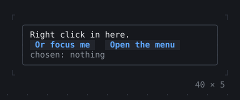
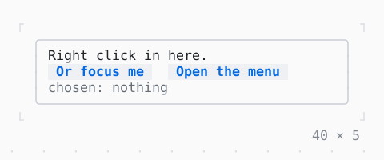

# ContextMenu

A menu at the mouse on a right click, under the focus on Shift+F10, or where a MenuController opens it.

| Dark | Light |
| --- | --- |
|  |  |

## Code

The Dart that builds it, as the gallery's Code tab shows it with the
options as they start:

```dart
final _menu = MenuController();
String? _chosen;
var _copied = false;

@override
void dispose() {
  _menu.dispose();
  super.dispose();
}

void _choose(String what) => setState(() {
  _chosen = what;
  _copied |= what == 'Cut' || what == 'Copy';
});

@override
Widget build(BuildContext context) => ContextMenu(
  controller: _menu,
  items: [
    MenuItem('Cu&t', onSelected: () => _choose('Cut')),
    MenuItem('&Copy', onSelected: () => _choose('Copy')),
    MenuItem('&Paste', onSelected: _copied ? () => _choose('Paste') : null),
    const MenuDivider(),
    MenuItem('Select &all', onSelected: () => _choose('Select all')),
  ],
  child: SizedBox(
    width: 40,
    height: 5,
    child: Box(
      border: .all(type: .rounded, style: Theme.of(context).border),
      padding: const .x(1),
      child: Column(
        crossAxisAlignment: .start,
        children: [
          const Text('Right click in here.'),
          Row(
            gap: 2,
            children: [
              Button('Or focus me', onPressed: () {}),
              // at a cell of the child, as a right click there
              Button(
                'Open the menu',
                onPressed: () => _menu.open(null, (22, 1)),
              ),
            ],
          ),
          Text.rich([
            Span('chosen: ', Theme.of(context).muted),
            switch (_chosen) {
              null => Span('nothing', Theme.of(context).muted),
              final chosen => Span(chosen),
            },
          ]),
        ],
      ),
    ),
  ),
);
```

## Options

What the gallery lets you change, and what each starts at:

| option | values | starts at |
| --- | --- | --- |
| look | raised, bordered | raised |

## More

- API: [`ContextMenu`](https://pub.dev/documentation/twk/latest/twk/ContextMenu-class.html).
- Also in Overlays: [Overlay](overlay.md), [App](app.md), [Dialog](dialog.md), [Toast](toast.md), [Tooltip](tooltip.md), [Popover](popover.md), [MenuBar](menubar.md), [CommandPalette](commandpalette.md), [OptionList](optionlist.md), [ModalBarrier](modalbarrier.md), [WindowLayer](windowlayer.md).
- Live in the gallery:
  `dart run packages/gallery/bin/gallery.dart --route='#/overlays/contextmenu'`.
- [Overlays](../overlays.md) · [All groups](../README.md)
