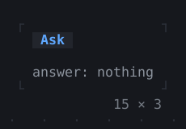
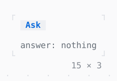

# Dialog

A box over the app, the rest dimmed behind a barrier; Tab stays in it, Escape closes it.

| Dark | Light |
| --- | --- |
|  |  |

## Code

The Dart that builds it, as the gallery's Code tab shows it with the
options as they start:

```dart
String? _answer;

void _ask() => unawaited(
  showDialog<bool>(
    context,
    (context) => Dialog(
      title: 'Delete',
      child: Column(
        mainAxisSize: .min,
        crossAxisAlignment: .start,
        gap: 1,
        children: [
          const Text('Delete 3 files?'),
          Row(
            mainAxisSize: .min,
            gap: 2,
            children: [
              Button(
                'Delete',
                autofocus: true,
                onPressed: () => closeDialog(context, true),
              ),
              Button('Keep', onPressed: () => closeDialog(context, false)),
            ],
          ),
        ],
      ),
    ),
    alignment: .center,
  ).then(
    (delete) => setState(
      () => _answer = switch (delete) {
        true => 'deleted',
        false => 'kept',
        null => 'dismissed',
      },
    ),
  ),
);

@override
Widget build(BuildContext context) => Column(
  mainAxisSize: .min,
  crossAxisAlignment: .start,
  gap: 1,
  children: [
    Button('Ask', onPressed: _ask),
    Text.rich([
      Span('answer: ', Theme.of(context).muted),
      switch (_answer) {
        null => Span('nothing', Theme.of(context).muted),
        final answer => Span(answer),
      },
    ]),
  ],
);
```

## Options

What the gallery lets you change, and what each starts at:

| option | values | starts at |
| --- | --- | --- |
| alignment | center, topCenter, bottomRight | center |
| shadow | on, off | false |
| look | raised, bordered | raised |
| dismissible | on, off | true |

## More

- API: [`Dialog`](https://pub.dev/documentation/twk/latest/twk/Dialog-class.html).
- Also in Overlays: [Overlay](overlay.md), [Toast](toast.md), [Tooltip](tooltip.md), [Popover](popover.md), [MenuBar](menubar.md), [ContextMenu](contextmenu.md), [CommandPalette](commandpalette.md), [OptionList](optionlist.md), [ModalBarrier](modalbarrier.md), [WindowLayer](windowlayer.md).
- Live in the gallery:
  `dart run packages/gallery/bin/gallery.dart --route='#/overlays/dialog'`.
- [Overlays](../overlays.md) · [All groups](../README.md)
