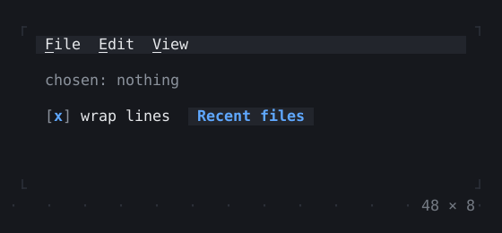
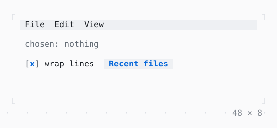

# MenuBar

Menus in a bar: F10 or a click opens one, Alt and a mnemonic too, or a MenuController from the app; the arrows, Enter and the mnemonics choose.

| Dark | Light |
| --- | --- |
|  |  |

## Code

The Dart that builds it, as the gallery's Code tab shows it with the
options as they start:

```dart
final _menus = MenuController();
String? _chosen;
var _wrap = true;
var _numbers = false;

@override
void dispose() {
  _menus.dispose();
  super.dispose();
}

void _choose(String what) => setState(() => _chosen = what);
void _open() => _choose('Open');
void _save() => _choose('Save');
void _undo() => _choose('Undo');

@override
Widget build(BuildContext context) {
  final child = Padding(
    padding: const .all(1),
    child: Column(
      crossAxisAlignment: .start,
      gap: 1,
      children: [
        Text.rich([
          Span('chosen: ', Theme.of(context).muted),
          switch (_chosen) {
            null => Span('nothing', Theme.of(context).muted),
            final chosen => Span(chosen),
          },
        ]),
        Row(
          gap: 2,
          children: [
            Checkbox(
              value: _wrap,
              label: 'wrap lines',
              onChanged: (value) => setState(() => _wrap = value),
            ),
            // File › Open recent, opened from outside the bar
            Button(
              'Recent files',
              onPressed: () => _menus.open([0, 2]),
            ),
          ],
        ),
      ],
    ),
  );
  return SizedBox(
    width: 48,
    height: 8,
    child: MenuBar(
      controller: _menus,
      menus: [
        Menu(
          '&File',
          items: [
            MenuItem('&New', onSelected: () => _choose('New')),
            MenuItem('&Open…', onSelected: _open),
            Menu(
              'Open &recent',
              items: [
                for (final file in const [
                  'main.dart',
                  'page.dart',
                  'overlay.dart',
                ])
                  MenuItem(file, onSelected: () => _choose(file)),
              ],
            ),
            const MenuDivider(),
            MenuItem('&Save', onSelected: _save),
            const MenuItem('&Print'),
          ],
        ),
        Menu(
          '&Edit',
          items: [
            MenuItem('&Undo', onSelected: _undo),
            const MenuItem('&Redo'),
            const MenuDivider(),
            for (final what in const ['Cu&t', '&Copy', '&Paste'])
              MenuItem(
                what,
                onSelected: () => _choose(what.replaceAll('&', '')),
              ),
          ],
        ),
        Menu(
          '&View',
          items: [
            MenuItem(
              '&Wrap lines',
              checked: _wrap,
              onSelected: () => setState(() {
                _wrap = !_wrap;
                _chosen = 'Wrap lines';
              }),
            ),
            MenuItem(
              'Line &numbers',
              checked: _numbers,
              onSelected: () => setState(() {
                _numbers = !_numbers;
                _chosen = 'Line numbers';
              }),
            ),
          ],
        ),
      ],
      // the items show the keys bound to what they call
      child: KeyBindings(
        {'ctrl+o': _open, 'ctrl+s': _save, 'ctrl+z': _undo},
        child: child,
      ),
    ),
  );
}
```

## Options

What the gallery lets you change, and what each starts at:

| option | values | starts at |
| --- | --- | --- |
| keys bound | on, off | true |
| look | raised, bordered | raised |

## More

- API: [`MenuBar`](https://pub.dev/documentation/twk/latest/twk/MenuBar-class.html).
- Also in Overlays: [Overlay](overlay.md), [Dialog](dialog.md), [Toast](toast.md), [Tooltip](tooltip.md), [Popover](popover.md), [ContextMenu](contextmenu.md), [CommandPalette](commandpalette.md), [OptionList](optionlist.md), [ModalBarrier](modalbarrier.md), [WindowLayer](windowlayer.md).
- Live in the gallery:
  `dart run packages/gallery/bin/gallery.dart --route='#/overlays/menubar'`.
- [Overlays](../overlays.md) · [All groups](../README.md)
