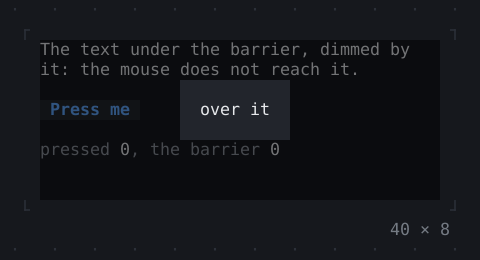
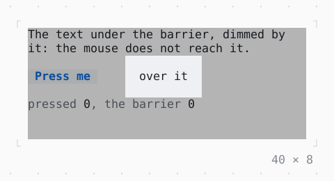

# ModalBarrier

What dims the app under a dialog and keeps the mouse from it.

| Dark | Light |
| --- | --- |
|  |  |

## Code

The Dart that builds it, as the gallery's Code tab shows it with the
options as they start:

```dart
var _pressed = 0;
var _dismissed = 0;

@override
Widget build(BuildContext context) => SizedBox(
  width: 40,
  height: 8,
  child: Stack(
    fit: .expand,
    children: [
      Column(
        crossAxisAlignment: .start,
        gap: 1,
        children: [
          const Text(
            'The text under the barrier, dimmed by it: the mouse does not '
            'reach it.',
          ),
          Button('Press me', onPressed: () => setState(() => _pressed++)),
          Text.rich([
            Span('pressed ', Theme.of(context).muted),
            Span('$_pressed'),
            Span(', the barrier ', Theme.of(context).muted),
            Span('$_dismissed'),
          ]),
        ],
      ),
      ModalBarrier(
        onDismiss: () => setState(() => _dismissed++),
      ),
      const Center(
        child: Panel(
          padding: .x(1),
          shadow: false,
          child: Text('over it'),
        ),
      ),
    ],
  ),
);
```

## Options

What the gallery lets you change, and what each starts at:

| option | values | starts at |
| --- | --- | --- |
| barrier | on, off | true |
| alpha | ¼, ½, ¾ | ½ |
| fade | on, off | false |

## More

- API: [`ModalBarrier`](https://pub.dev/documentation/twk/latest/twk/ModalBarrier-class.html).
- Also in Overlays: [Overlay](overlay.md), [App](app.md), [Dialog](dialog.md), [Toast](toast.md), [Tooltip](tooltip.md), [Popover](popover.md), [MenuBar](menubar.md), [ContextMenu](contextmenu.md), [CommandPalette](commandpalette.md), [OptionList](optionlist.md), [WindowLayer](windowlayer.md).
- Live in the gallery:
  `dart run packages/gallery/bin/gallery.dart --route='#/overlays/modalbarrier'`.
- [Overlays](../overlays.md) · [All groups](../README.md)
