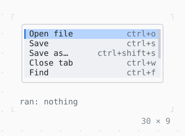

# OptionList

Options in rows, one highlighted, the characters a query matched standing out and a detail at the right edge: what an autocomplete, a Select and a command palette list.

| Dark | Light |
| --- | --- |
|  |  |

## Code

The Dart that builds it, as the gallery's Code tab shows it with the
options as they start:

```dart
const _commands = [
  ('Open file', 'ctrl+o'),
  ('Save', 'ctrl+s'),
  ('Save as…', 'ctrl+shift+s'),
  ('Close tab', 'ctrl+w'),
  ('Find', 'ctrl+f'),
  ('Replace', 'ctrl+h'),
  ('Go to line', 'ctrl+g'),
  ('Toggle theme', 'ctrl+t'),
  ('Quit', 'ctrl+q'),
];

var _highlighted = 0;
String? _ran;

@override
Widget build(BuildContext context) {
  final theme = Theme.of(context);
  final options = [
    for (final (label, keys) in _commands) Option(label, detail: keys),
  ];
  final highlighted = _highlighted.clamp(0, options.length - 1);
  void highlight(int i) => setState(() => _highlighted = i);
  void move(int by) =>
      highlight((highlighted + by).clamp(0, options.length - 1));
  void run(int i) => setState(() => _ran = options[i].label);
  return Column(
    mainAxisSize: .min,
    crossAxisAlignment: .start,
    gap: 1,
    children: [
      // the list takes no keys: a Pressable around it
      // does, its border primary while it has the focus
      Pressable(
        bindings: {
          'up': () => move(-1),
          'down': () => move(1),
          'enter': () => run(highlighted),
        },
        hints: const {'up': 'select', 'down': 'select', 'enter': 'run'},
        builder: (context, focused) => Box(
          border: .all(
            type: .rounded,
            style: focused ? theme.primary : theme.border,
          ),
          child: OptionList(
            options: options,
            highlighted: highlighted,
            rows: 5,
            onHighlight: highlight,
            onSelected: run,
          ),
        ),
      ),
      Text.rich([
        Span('ran: ', theme.muted),
        if (_ran case final ran?)
          Span(ran)
        else
          Span('nothing', theme.muted),
      ]),
    ],
  );
}
```

## Options

What the gallery lets you change, and what each starts at:

| option | values | starts at |
| --- | --- | --- |
| marks of | none, o, sa | none |
| rows | 3, 5, 8 | 5 |
| details | on, off | true |
| bar | on, off | true |
| thumb | on, off | true |

## More

- API: [`OptionList`](https://pub.dev/documentation/twk/latest/twk/OptionList-class.html).
- Also in Overlays: [Overlay](overlay.md), [Dialog](dialog.md), [Toast](toast.md), [Tooltip](tooltip.md), [Popover](popover.md), [MenuBar](menubar.md), [ContextMenu](contextmenu.md), [CommandPalette](commandpalette.md), [ModalBarrier](modalbarrier.md), [WindowLayer](windowlayer.md).
- Live in the gallery:
  `dart run packages/gallery/bin/gallery.dart --route='#/overlays/optionlist'`.
- [Overlays](../overlays.md) · [All groups](../README.md)
