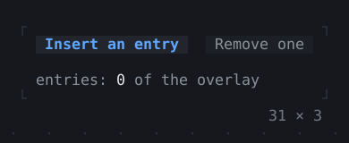
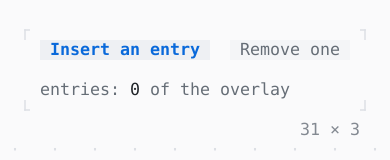

# Overlay

A layer over the app that dialogs, toasts, menus and tooltips go in; an entry of its own goes in it too.

| Dark | Light |
| --- | --- |
|  |  |

## Code

The Dart that builds it, as the gallery's Code tab shows it with the
options as they start:

```dart
final _entries = <OverlayEntry>[];

@override
void dispose() {
  for (final entry in _entries) {
    entry.remove();
  }
  super.dispose();
}

void _insert() {
  final n = _entries.length + 1;
  final entry = OverlayEntry(
    builder: (context) => Positioned(
      right: 4 * n - 3,
      top: 2 * n - 1,
      child: Panel(
        padding: const .x(1),
        child: Text.rich([
          'Entry $n'.bold,
          Span(' of the overlay', Theme.of(context).muted),
        ]),
      ),
    ),
  );
  Overlay.of(context).insert(entry);
  setState(() => _entries.add(entry));
}

void _remove() => setState(() => _entries.removeLast().remove());

@override
Widget build(BuildContext context) => Column(
  mainAxisSize: .min,
  crossAxisAlignment: .start,
  gap: 1,
  children: [
    Row(
      mainAxisSize: .min,
      gap: 2,
      children: [
        Button(
          'Insert an entry',
          onPressed: _entries.length < 3 ? _insert : null,
        ),
        Button('Remove one', onPressed: _entries.isEmpty ? null : _remove),
      ],
    ),
    Text.rich([
      Span('entries: ', Theme.of(context).muted),
      Span('${_entries.length}'),
      Span(' of the overlay', Theme.of(context).muted),
    ]),
  ],
);
```

## Options

What the gallery lets you change, and what each starts at:

| option | values | starts at |
| --- | --- | --- |
| positioned | topRight, topLeft, bottomLeft | topRight |
| shadow | on, off | true |
| look | raised, bordered | raised |

## More

- API: [`Overlay`](https://pub.dev/documentation/twk/latest/twk/Overlay-class.html).
- Also in Overlays: [App](app.md), [Dialog](dialog.md), [Toast](toast.md), [Tooltip](tooltip.md), [Popover](popover.md), [MenuBar](menubar.md), [ContextMenu](contextmenu.md), [CommandPalette](commandpalette.md), [OptionList](optionlist.md), [ModalBarrier](modalbarrier.md), [WindowLayer](windowlayer.md).
- Live in the gallery:
  `dart run packages/gallery/bin/gallery.dart --route='#/overlays/overlay'`.
- [Overlays](../overlays.md) · [All groups](../README.md)
