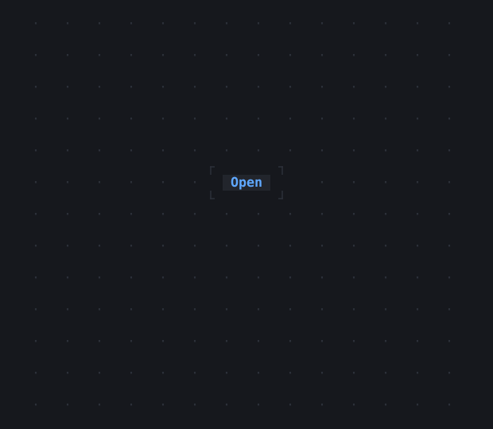

# Popover

A widget by another while the app says so, placed by an AnchorTarget around it and an AnchorFollower in the overlay; Escape or a click outside closes it.

| Dark | Light |
| --- | --- |
|  |  |

## Code

The Dart that builds it, as the gallery's Code tab shows it with the
options as they start:

```dart
var _open = false;

@override
Widget build(BuildContext context) {
  final theme = Theme.of(context);
  return Popover(
    open: _open,
    onDismiss: () => setState(() => _open = false),
    popover: Panel(
      padding: const .x(1),
      child: Column(
        mainAxisSize: .min,
        crossAxisAlignment: .start,
        children: [
          const Text('The popover, by the button.'),
          Text('Escape or a click outside closes it.', style: theme.muted),
        ],
      ),
    ),
    child: Button(
      _open ? 'Close' : 'Open',
      onPressed: () => setState(() => _open = !_open),
    ),
  );
}
```

## Options

What the gallery lets you change, and what each starts at:

| option | values | starts at |
| --- | --- | --- |
| dismissible | on, off | true |
| look | raised, bordered | raised |

## More

- API: [`Popover`](https://pub.dev/documentation/twk/latest/twk/Popover-class.html).
- Also in Overlays: [Overlay](overlay.md), [Dialog](dialog.md), [Toast](toast.md), [Tooltip](tooltip.md), [MenuBar](menubar.md), [ContextMenu](contextmenu.md), [CommandPalette](commandpalette.md), [OptionList](optionlist.md), [ModalBarrier](modalbarrier.md), [WindowLayer](windowlayer.md).
- Live in the gallery:
  `dart run packages/gallery/bin/gallery.dart --route='#/overlays/popover'`.
- [Overlays](../overlays.md) · [All groups](../README.md)
