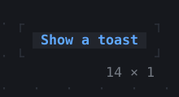
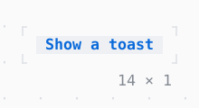

# Toast

A message that shows for a while and goes, over a corner of the app.

| Dark | Light |
| --- | --- |
|  |  |

## Code

The Dart that builds it, as the gallery's Code tab shows it with the
options as they start:

```dart
var _n = 0;

void _show() {
  final theme = Theme.of(context);
  final (message, style) = [
    ('Saved 3 files.', theme.success),
    ('Copied the path.', theme.info),
    ('Disk nearly full.', theme.warning),
    ('Upload failed.', theme.error),
  ][_n++ % 4];
  showToast(
    context,
    message,
    alignment: .bottomRight,
    style: style,
  );
}

@override
Widget build(BuildContext context) => Button('Show a toast', onPressed: _show);
```

## Options

What the gallery lets you change, and what each starts at:

| option | values | starts at |
| --- | --- | --- |
| alignment | bottomRight, topRight, bottomCenter | bottomRight |
| duration | 1 s, 3 s, 5 s | 3 s |
| look | raised, bordered | raised |

## More

- Also in Overlays: [Overlay](overlay.md), [App](app.md), [Dialog](dialog.md), [Tooltip](tooltip.md), [Popover](popover.md), [MenuBar](menubar.md), [ContextMenu](contextmenu.md), [CommandPalette](commandpalette.md), [OptionList](optionlist.md), [ModalBarrier](modalbarrier.md), [WindowLayer](windowlayer.md).
- Live in the gallery:
  `dart run packages/gallery/bin/gallery.dart --route='#/overlays/toast'`.
- [Overlays](../overlays.md) · [All groups](../README.md)
