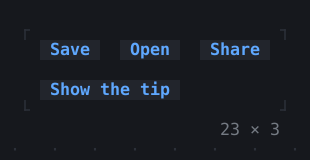
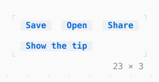

# Tooltip

A message by a widget while the mouse or the keyboard focus rests on it, or while a TooltipController says, centred under it by an AnchorFollower in the overlay; above it where there is no room below.

| Dark | Light |
| --- | --- |
|  |  |

## Code

The Dart that builds it, as the gallery's Code tab shows it with the
options as they start:

```dart
final _share = TooltipController();

@override
void dispose() {
  _share.dispose();
  super.dispose();
}

@override
Widget build(BuildContext context) => Column(
  mainAxisSize: .min,
  crossAxisAlignment: .start,
  gap: 1,
  children: [
    Row(
      mainAxisSize: .min,
      gap: 2,
      children: [
        for (final (label, message, done) in const [
          ('Save', 'Saves the file', 'Saved'),
          ('Open', 'Opens a file', 'Opened'),
          ('Share', 'Copies a link to it', 'Link copied'),
        ])
          Tooltip(
            message: message,
            controller: label == 'Share' ? _share : null,
            child: Button(
              label,
              onPressed: () => showToast(
                context,
                done,
                style: Theme.of(context).success,
              ),
            ),
          ),
      ],
    ),
    // shows the Share message at once, until it is pressed again
    ListenableBuilder(
      listenable: _share,
      builder: (context, _) => Button(
        _share.isShown ? 'Hide the tip' : 'Show the tip',
        onPressed: _share.isShown ? _share.hide : _share.show,
      ),
    ),
  ],
);
```

## Options

What the gallery lets you change, and what each starts at:

| option | values | starts at |
| --- | --- | --- |
| wait | 100 ms, 500 ms, 1 s | 500 ms |
| on hover | on, off | true |
| on focus | on, off | true |
| look | raised, bordered | raised |

## More

- API: [`Tooltip`](https://pub.dev/documentation/twk/latest/twk/Tooltip-class.html).
- Also in Overlays: [Overlay](overlay.md), [App](app.md), [Dialog](dialog.md), [Toast](toast.md), [Popover](popover.md), [MenuBar](menubar.md), [ContextMenu](contextmenu.md), [CommandPalette](commandpalette.md), [OptionList](optionlist.md), [ModalBarrier](modalbarrier.md), [WindowLayer](windowlayer.md).
- Live in the gallery:
  `dart run packages/gallery/bin/gallery.dart --route='#/overlays/tooltip'`.
- [Overlays](../overlays.md) · [All groups](../README.md)
