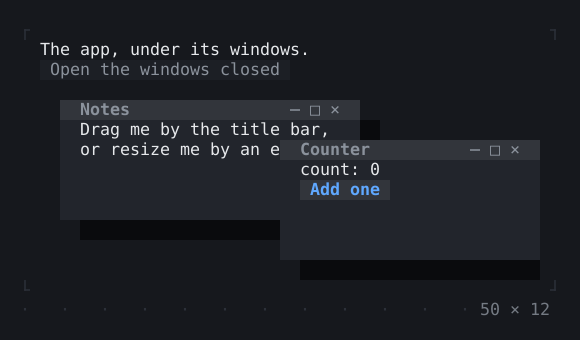
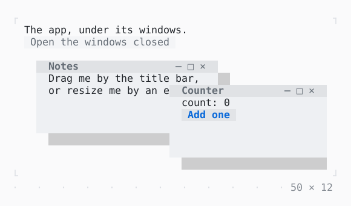

# WindowLayer

Windows over the app: a title bar drags one, an edge resizes it, its buttons minimise, maximise and close it; Tab to a title bar, then the arrows move it.

| Dark | Light |
| --- | --- |
|  |  |

## Code

The Dart that builds it, as the gallery's Code tab shows it with the
options as they start:

```dart
final _notes = WindowController(left: 2, top: 3, width: 30, height: 6);
final _counter = WindowController(left: 24, top: 5, width: 26, height: 6);
final _closed = <String>{};
var _count = 0;

@override
void dispose() {
  _notes.dispose();
  _counter.dispose();
  super.dispose();
}

void _close(String title) => setState(() => _closed.add(title));

@override
Widget build(BuildContext context) => SizedBox(
  width: 50,
  height: 12,
  child: WindowLayer(
    windows: [
      if (!_closed.contains('Notes'))
        Window(
          key: const ValueKey('Notes'),
          title: 'Notes',
          controller: _notes,
          onClose: () => _close('Notes'),
          shadow: Panel.shadowOf(Theme.of(context)),
          child: const Padding(
            padding: .x(1),
            child: Text('Drag me by the title bar, or resize me by an edge.'),
          ),
        ),
      if (!_closed.contains('Counter'))
        Window(
          key: const ValueKey('Counter'),
          title: 'Counter',
          controller: _counter,
          onClose: () => _close('Counter'),
          shadow: Panel.shadowOf(Theme.of(context)),
          child: Padding(
            padding: const .x(1),
            child: Column(
              crossAxisAlignment: .start,
              children: [
                Text('count: $_count'),
                Button('Add one', onPressed: () => setState(() => _count++)),
              ],
            ),
          ),
        ),
    ],
    child: Column(
      crossAxisAlignment: .start,
      children: [
        const Text('The app, under its windows.'),
        Button(
          'Open the windows closed',
          onPressed: _closed.isEmpty ? null : () => setState(_closed.clear),
        ),
      ],
    ),
  ),
);
```

## Options

What the gallery lets you change, and what each starts at:

| option | values | starts at |
| --- | --- | --- |
| frame | raised, bordered | raised |
| shadow | on, off | true |
| resizable | on, off | true |
| minimisable | on, off | true |
| maximisable | on, off | true |

## More

- API: [`WindowLayer`](https://pub.dev/documentation/twk/latest/twk/WindowLayer-class.html).
- Also in Overlays: [Overlay](overlay.md), [App](app.md), [Dialog](dialog.md), [Toast](toast.md), [Tooltip](tooltip.md), [Popover](popover.md), [MenuBar](menubar.md), [ContextMenu](contextmenu.md), [CommandPalette](commandpalette.md), [OptionList](optionlist.md), [ModalBarrier](modalbarrier.md).
- Live in the gallery:
  `dart run packages/gallery/bin/gallery.dart --route='#/overlays/windowlayer'`.
- [Overlays](../overlays.md) · [All groups](../README.md)
