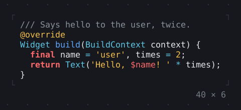
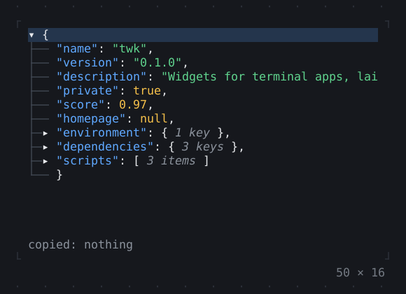

# Rich

Markdown, code, diffs, JSON, big text, QR codes and program output with its colors.

[All groups](README.md)

| | |
| --- | --- |
|  **[MarkdownView](rich/markdownview.md)** A Markdown document as widgets, a blank row between the blocks; its links the app's with onLinkTap, a MarkdownController scrolling to a heading. In `twk_rich`. |  **[CodeView](rich/codeview.md)** Source code highlighted for its language, with line numbers, its long lines wrapped or cut off at the width; a CodeViewController scrolls it to a line, highlights lines and finds text. In `twk_rich`. |
|  **[SyntaxThemeScope](rich/syntaxthemescope.md)** The styles of the code below it, a style for each kind of token, in place of those derived from the theme: a SyntaxTheme of its own, or the derived one with a few changed. In `twk_rich`. |  **[DiffView](rich/diffview.md)** The changes between two texts, unified or side by side, the words that changed marked and both sides highlighted. In `twk_rich`. |
|  **[JsonView](rich/jsonview.md)** JSON or a Dart value as a tree that folds, each kind of value in its color: c copies the path of the value selected, y the value, / filters the keys. In `twk_rich`. |  **[BigText](rich/bigtext.md)** Text in letters several cells tall, drawn with full or half blocks or with box drawing, in a font of its own. In `twk_rich`. |
|  **[QrCode](rich/qrcode.md)** Text as a QR code a phone's camera reads: in half blocks, two modules to a cell, black on white whatever the theme, with as much of the quiet zone around it as the rows allow. In `twk_rich`. |  **[ANSI](rich/ansi.md)** Output with ANSI colour codes, from a program or a log, as styled spans: all at once with parseAnsi, or as it streams in with AnsiStream. In `twk_rich`. |

