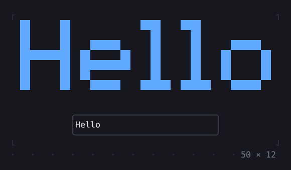
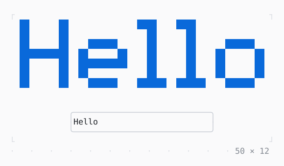

# BigText

Text in letters several cells tall, drawn with full or half blocks or with box drawing, in a font of its own.

| Dark | Light |
| --- | --- |
|  |  |

In [twk_rich](../../../packages/twk_rich/README.md), besides twk.

## Code

The Dart that builds it, as the gallery's Code tab shows it with the
options as they start:

```dart
final _controller = TextEditingController(text: 'Hello');
final _focus = FocusNode(debugLabel: 'text');

@override
void initState() {
  super.initState();
  _focus.addListener(() => setState(() {}));
}

@override
void dispose() {
  _controller.dispose();
  _focus.dispose();
  super.dispose();
}

@override
Widget build(BuildContext context) {
  final theme = Theme.of(context);
  return Column(
    mainAxisSize: .min,
    gap: 1,
    children: [
      // what the field and the gap leave: the font that fits in it
      Flexible(child: BigText(_controller.text, style: theme.primary)),
      SizedBox(
        width: 30,
        child: Box(
          border: .all(
            type: .rounded,
            style: _focus.hasFocus ? theme.primary : theme.border,
          ),
          child: TextField(
            controller: _controller,
            focusNode: _focus,
            placeholder: 'type here',
            maxLength: 24,
            onChanged: (_) => setState(() {}),
          ),
        ),
      ),
    ],
  );
}
```

## Options

What the gallery lets you change, and what each starts at:

| option | values | starts at |
| --- | --- | --- |
| font | fit, large, block, thin, small | fit |
| text | typed, clock, two lines | typed |
| align | left, center, right | left |
| style | primary, accent, success, warning, info | primary |

## More

- Also in Rich: [MarkdownView](markdownview.md), [CodeView](codeview.md), [SyntaxThemeScope](syntaxthemescope.md), [DiffView](diffview.md), [JsonView](jsonview.md), [QrCode](qrcode.md).
- Live in the gallery:
  `dart run packages/gallery/bin/gallery.dart --route='#/rich/bigtext'`.
- [Rich](../rich.md) · [All groups](../README.md)
