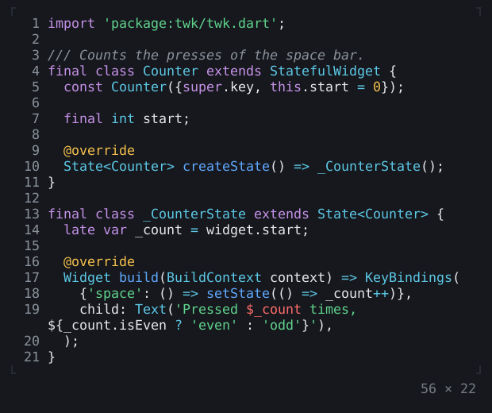
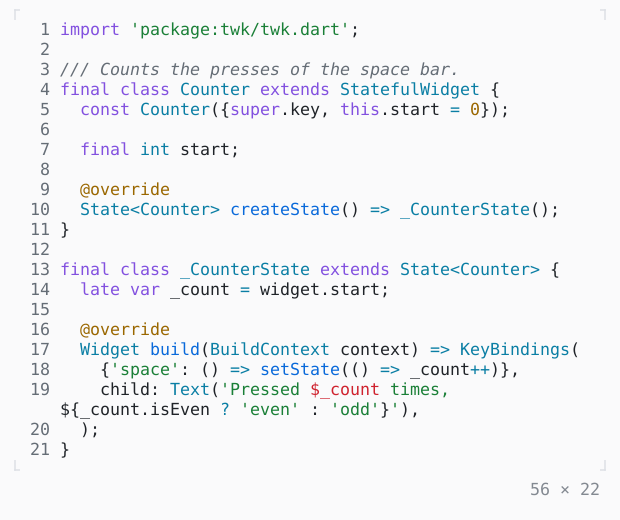

# CodeView

Source code highlighted for its language, with line numbers, its long lines wrapped or cut off at the width; a CodeViewController scrolls it to a line, highlights lines and finds text.

| Dark | Light |
| --- | --- |
|  |  |

In [twk_rich](../../../packages/twk_rich/README.md), besides twk.

## Code

The Dart that builds it, as the gallery's Code tab shows it with the
options as they start:

```dart
const _source = r'''
import 'package:twk/twk.dart';

/// Counts the presses of the space bar.
final class Counter extends StatefulWidget {
  const Counter({super.key, this.start = 0});

  final int start;

  @override
  State<Counter> createState() => _CounterState();
}

final class _CounterState extends State<Counter> {
  late var _count = widget.start;

  @override
  Widget build(BuildContext context) => KeyBindings(
    {'space': () => setState(() => _count++)},
    child: Text('Pressed $_count times, ${_count.isEven ? 'even' : 'odd'}'),
  );
}
''';

@override
Widget build(BuildContext context) {
  final theme = Theme.of(context);
  return SizedBox(
    width: 56,
    height: 22,
    child: Scrollbar(
      style: theme.border,
      child: SingleChildScrollView(
        child: CodeView(
          _source,
          language: dartLanguage,
          lineNumbers: true,
          wrap: .word,
        ),
      ),
    ),
  );
}
```

## Options

What the gallery lets you change, and what each starts at:

| option | values | starts at |
| --- | --- | --- |
| language | Dart, Python, Rust, Go, JavaScript, TypeScript, JSON, YAML, Bash, diff, plain | Dart |
| line numbers | on, off | true |
| changes | on, off | false |
| wrap | none, word, grapheme | word |
| width | 24 cells to 80 cells | 56 |
| rows | all, 10 | all |
| first line | 1, 120 | 1 |
| to line 18 | none, least, ½ | none |
| highlight | none, 14, 13–16 | none |
| find | on, off | false |

## More

- Also in Rich: [MarkdownView](markdownview.md), [SyntaxThemeScope](syntaxthemescope.md), [DiffView](diffview.md), [JsonView](jsonview.md), [BigText](bigtext.md), [QrCode](qrcode.md).
- Live in the gallery:
  `dart run packages/gallery/bin/gallery.dart --route='#/rich/codeview'`.
- [Rich](../rich.md) · [All groups](../README.md)
