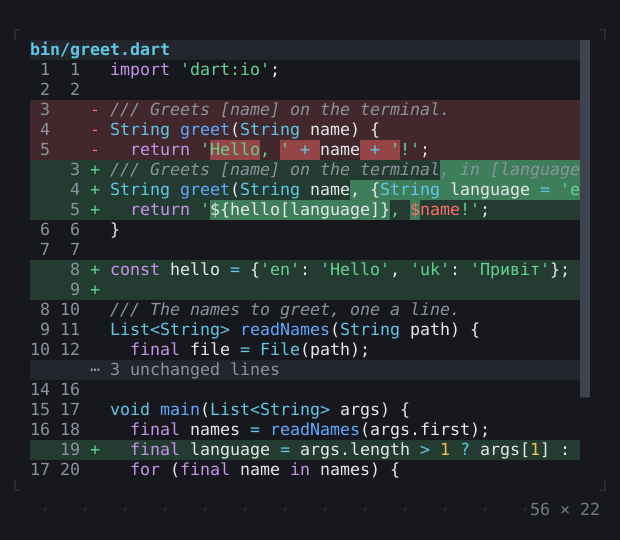
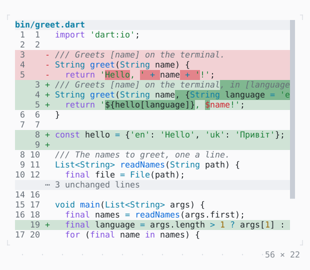

# DiffView

The changes between two texts, unified or side by side, the words that changed marked and both sides highlighted.

| Dark | Light |
| --- | --- |
|  |  |

In [twk_rich](../../../packages/twk_rich/README.md), besides twk.

## Code

The Dart that builds it, as the gallery's Code tab shows it with the
options as they start:

```dart
const _before = r'''
import 'dart:io';

/// Greets [name] on the terminal.
String greet(String name) {
  return 'Hello, ' + name + '!';
}

/// The names to greet, one a line.
List<String> readNames(String path) {
  final file = File(path);
  final lines = file.readAsLinesSync();
  return lines.where((l) => l.isNotEmpty).toList();
}

void main(List<String> args) {
  final names = readNames(args.first);
  for (final name in names) {
    print(greet(name));
  }
  print('Greeted ${names.length} names.');
}
''';

const _after = r'''
import 'dart:io';

/// Greets [name] on the terminal, in [language].
String greet(String name, {String language = 'en'}) {
  return '${hello[language]}, $name!';
}

const hello = {'en': 'Hello', 'uk': 'Привіт'};

/// The names to greet, one a line.
List<String> readNames(String path) {
  final file = File(path);
  final lines = file.readAsLinesSync();
  return lines.where((l) => l.isNotEmpty).toList();
}

void main(List<String> args) {
  final names = readNames(args.first);
  final language = args.length > 1 ? args[1] : 'en';
  for (final name in names) {
    print(greet(name, language: language));
  }
}
''';

final _diff = Diff.between(_before, _after, path: 'bin/greet.dart');

@override
Widget build(BuildContext context) {
  return SizedBox(
    width: 56,
    height: 22,
    child: Scrollbar(
      style: Theme.of(context).border,
      child: DiffView(_diff),
    ),
  );
}
```

## Options

What the gallery lets you change, and what each starts at:

| option | values | starts at |
| --- | --- | --- |
| layout | unified, sideBySide | unified |
| context | 3 lines, 1, 0 | 3 lines |
| edit live | on, off | false |
| language | the path's, plain | the path's |

## More

- Also in Rich: [MarkdownView](markdownview.md), [CodeView](codeview.md), [SyntaxThemeScope](syntaxthemescope.md), [JsonView](jsonview.md), [BigText](bigtext.md), [QrCode](qrcode.md).
- Live in the gallery:
  `dart run packages/gallery/bin/gallery.dart --route='#/rich/diffview'`.
- [Rich](../rich.md) · [All groups](../README.md)
