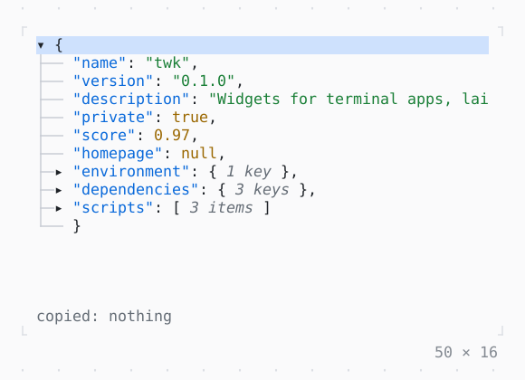

# JsonView

JSON or a Dart value as a tree that folds, each kind of value in its color: c copies the path of the value selected, y the value, / filters the keys.

| Dark | Light |
| --- | --- |
|  |  |

In [twk_rich](../../../packages/twk_rich/README.md), besides twk.

## Code

The Dart that builds it, as the gallery's Code tab shows it with the
options as they start:

```dart
static const _package = {
  'name': 'twk',
  'version': '0.1.0',
  'description': 'Widgets for terminal apps, laid out as Flutter lays them',
  'private': true,
  'score': 0.97,
  'homepage': null,
  'environment': {'sdk': '^3.13.5'},
  'dependencies': {'args': '^2.7.0', 'meta': '^1.16.0', 'path': '^1.9.1'},
  'scripts': ['quick', 'handover', 'bench'],
};

final _view = JsonViewController();
var _copied = '';

@override
void dispose() {
  _view.dispose();
  super.dispose();
}

@override
Widget build(BuildContext context) {
  final theme = Theme.of(context);
  return Column(
    mainAxisSize: .min,
    crossAxisAlignment: .start,
    gap: 1,
    children: [
      SizedBox(
        width: 50,
        height: 14,
        child: JsonView(
          value: _package,
          controller: _view,
          onPathCopied: (path) => setState(() => _copied = path),
        ),
      ),
      Text.rich([
        Span('copied: ', theme.muted),
        if (_copied.isEmpty)
          Span('nothing', theme.muted)
        else
          Span(_copied),
      ]),
    ],
  );
}
```

## Options

What the gallery lets you change, and what each starts at:

| option | values | starts at |
| --- | --- | --- |
| expanded depth | 1, 2, 0 | 1 |
| sort keys | on, off | false |
| strings cut at | 200, 24 | 200 |

## More

- Also in Rich: [MarkdownView](markdownview.md), [CodeView](codeview.md), [SyntaxThemeScope](syntaxthemescope.md), [DiffView](diffview.md), [BigText](bigtext.md), [QrCode](qrcode.md).
- Live in the gallery:
  `dart run packages/gallery/bin/gallery.dart --route='#/rich/jsonview'`.
- [Rich](../rich.md) · [All groups](../README.md)
