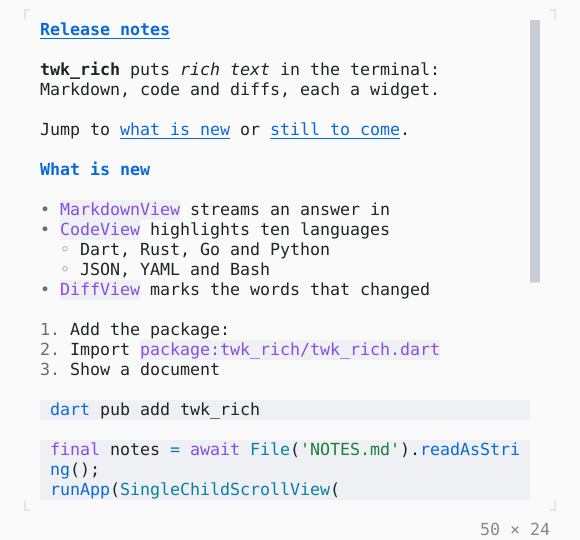

# MarkdownView

A Markdown document as widgets, a blank row between the blocks; its links the app's with onLinkTap, a MarkdownController scrolling to a heading.

| Dark | Light |
| --- | --- |
|  |  |

In [twk_rich](../../../packages/twk_rich/README.md), besides twk.

## Code

The Dart that builds it, as the gallery's Code tab shows it with the
options as they start:

```dart
const _notes =
    '# Release notes\n'
    '\n'
    '**twk_rich** puts *rich text* in the terminal: Markdown, code and diffs, '
    'each a widget.\n'
    '\n'
    'Jump to [what is new](#what-is-new) or [still to come](#still-to-come).\n'
    '\n'
    '## What is new\n'
    '\n'
    '- `MarkdownView` streams an answer in\n'
    '- `CodeView` highlights ten languages\n'
    '  - Dart, Rust, Go and Python\n'
    '  - JSON, YAML and Bash\n'
    '- `DiffView` marks the words that changed\n'
    '\n'
    '1. Add the package:\n'
    '2. Import `package:twk_rich/twk_rich.dart`\n'
    '3. Show a document\n'
    '\n'
    '```bash\n'
    'dart pub add twk_rich\n'
    '```\n'
    '\n'
    '```dart\n'
    "final notes = await File('NOTES.md').readAsString();\n"
    'runApp(SingleChildScrollView(\n'
    '  child: MarkdownView(notes),\n'
    '));\n'
    '```\n'
    '\n'
    '> Every block is a widget: this quote, the lists above and the table '
    'below.\n'
    '\n'
    '| widget       | shows       | scrolls |\n'
    '|:-------------|:------------|:-------:|\n'
    '| MarkdownView | documents   |   no    |\n'
    '| CodeView     | source code |   no    |\n'
    '| DiffView     | changes     |   yes   |\n'
    '\n'
    '### Still to come\n'
    '\n'
    '- [x] tables and task lists\n'
    '- [ ] ~~images~~ pictures in cells\n'
    '\n'
    'Read the [guide](https://dart.dev/tools) for more.\n'
    '\n'
    '---';

@override
Widget build(BuildContext context) => SizedBox(
  width: 50,
  height: 24,
  child: Scrollbar(
    style: Theme.of(context).border,
    child: SingleChildScrollView(
      child: MarkdownView(_notes),
    ),
  ),
);
```

## Options

What the gallery lets you change, and what each starts at:

| option | values | starts at |
| --- | --- | --- |
| content | document, chat answer | document |
| code wrap | grapheme, word, none | grapheme |
| width | 30 cells to 72 cells | 50 |
| links go to | the terminal, the app, the app only | the terminal |

## More

- Also in Rich: [CodeView](codeview.md), [SyntaxThemeScope](syntaxthemescope.md), [DiffView](diffview.md), [JsonView](jsonview.md), [BigText](bigtext.md), [QrCode](qrcode.md), [ANSI](ansi.md).
- Live in the gallery:
  `dart run packages/gallery/bin/gallery.dart --route='#/rich/markdownview'`.
- [Rich](../rich.md) · [All groups](../README.md)
