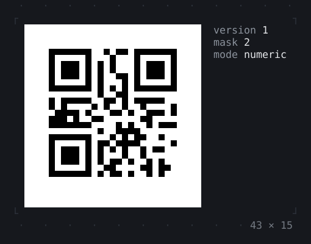
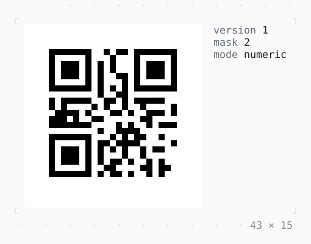

# QrCode

Text as a QR code a phone's camera reads: in half blocks, two modules to a cell, black on white whatever the theme, with as much of the quiet zone around it as the rows allow.

| Dark | Light |
| --- | --- |
|  |  |

In [twk_rich](../../../packages/twk_rich/README.md), besides twk.

## Code

The Dart that builds it, as the gallery's Code tab shows it with the
options as they start:

```dart
@override
Widget build(BuildContext context) {
  final theme = Theme.of(context);
  // the mode of fewest bits, the smallest version, the
  // mask the penalty rules score lowest
  final symbol = QrSymbol.encode('20261019', level: .medium);
  return LayoutBuilder(
    builder: (context, constraints) => Row(
      mainAxisSize: .min,
      crossAxisAlignment: .start,
      gap: 2,
      children: [
        // in half blocks, black on white; in fewer rows than it
        // asks for, a narrower quiet zone, the whole symbol shown
        QrCode.symbol(
          symbol,
          quietZone: ((2 * constraints.maxH - symbol.size) ~/ 2).clamp(0, 4),
        ),
        Text.rich([
          Span('version ', theme.muted),
          Span('${symbol.version}\n'),
          Span('mask ', theme.muted),
          Span('${symbol.mask}\n'),
          Span('mode ', theme.muted),
          Span(symbol.mode.name),
          // taller than the rows there are even without a quiet
          // zone: cut off at its bottom, which a camera can't read
          if ((symbol.size + 1) ~/ 2 > constraints.maxH) ...[
            Span('\n\nneeds ', theme.warning),
            Span('${(symbol.size + 1) ~/ 2} rows'),
          ],
        ]),
      ],
    ),
  );
}
```

## Options

What the gallery lets you change, and what each starts at:

| option | values | starts at |
| --- | --- | --- |
| text | link, wifi, digits | digits |
| level | low, medium, quartile, high | medium |
| quiet zone | 0 modules to 4 modules | 4 |
| inverted | on, off | false |

## More

- Also in Rich: [MarkdownView](markdownview.md), [CodeView](codeview.md), [SyntaxThemeScope](syntaxthemescope.md), [DiffView](diffview.md), [JsonView](jsonview.md), [BigText](bigtext.md), [ANSI](ansi.md).
- Live in the gallery:
  `dart run packages/gallery/bin/gallery.dart --route='#/rich/qrcode'`.
- [Rich](../rich.md) · [All groups](../README.md)
