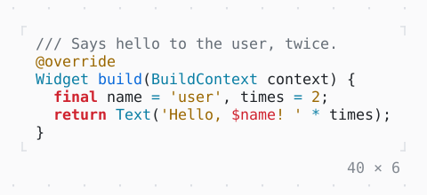

# SyntaxThemeScope

The styles of the code below it, a style for each kind of token, in place of those derived from the theme: a SyntaxTheme of its own, or the derived one with a few changed.

| Dark | Light |
| --- | --- |
|  |  |

In [twk_rich](../../../packages/twk_rich/README.md), besides twk.

## Code

The Dart that builds it, as the gallery's Code tab shows it with the
options as they start:

```dart
const _source = r'''
/// Says hello to the user, twice.
@override
Widget build(BuildContext context) {
  final name = 'user', times = 2;
  return Text('Hello, $name! ' * times);
}
''';

@override
Widget build(BuildContext context) {
  final theme = Theme.of(context);
  return SyntaxThemeScope(
    // the theme derived from the Theme, three kinds
    // of token changed
    theme: SyntaxTheme.from(theme).copyWith(
      keyword: theme.error.merge(const .new(attrs: Attr.bold)),
      string: theme.warning,
      comment: theme.muted,
    ),
    child: const CodeView(_source, language: dartLanguage),
  );
}
```

## Options

What the gallery lets you change, and what each starts at:

| option | values | starts at |
| --- | --- | --- |
| syntax theme | copyWith, own, none | copyWith |

## More

- Also in Rich: [MarkdownView](markdownview.md), [CodeView](codeview.md), [DiffView](diffview.md), [JsonView](jsonview.md), [BigText](bigtext.md), [QrCode](qrcode.md).
- Live in the gallery:
  `dart run packages/gallery/bin/gallery.dart --route='#/rich/syntaxthemescope'`.
- [Rich](../rich.md) · [All groups](../README.md)
