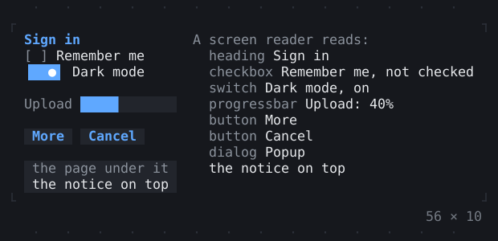
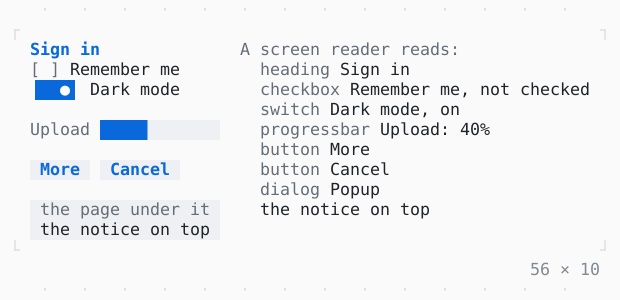

# Semantics

What a widget is to a screen reader: a role, a label, a value and a state, read as a line of text. TWK_SCREEN_READER=1 reads an app out so.

| Dark | Light |
| --- | --- |
|  |  |

## Code

The Dart that builds it, as the gallery's Code tab shows it with the
options as they start:

```dart
final GlobalKey _form = GlobalKey();

// of the controls, so that a move of the focus among them is read
final List<FocusNode> _nodes = [for (var i = 0; i < 4; i++) FocusNode()];

var _remember = false;
var _dark = true;
var _done = 4;

// the nodes of the form with a line, as a screen reader reads them
var _read = const <SemanticsNode>[];

@override
void initState() {
  super.initState();
  for (final node in _nodes) {
    node.addListener(_readNext);
  }
}

@override
void dispose() {
  for (final node in _nodes) {
    node.dispose();
  }
  super.dispose();
}

/// Reads the form at the start of the next frame, as this one built it.
void _readNext() =>
    AppBinding.maybeOf(context)?.scheduleFrameCallback((_) => _readForm());

void _readForm() {
  final form = _form.currentContext;
  if (!mounted || form == null) {
    return;
  }
  Iterable<SemanticsNode> withLines(SemanticsNode node) sync* {
    if (node.line.isNotEmpty) {
      yield node;
    }
    for (final child in node.children) {
      yield* withLines(child);
    }
  }

  final read = [...withLines(SemanticsNode.of(form))];
  String said(List<SemanticsNode> nodes) => [
    for (final n in nodes) '${n.focused} ${n.line}',
  ].join('\n');
  if (said(read) != said(_read)) {
    setState(() => _read = read);
  }
}

@override
Widget build(BuildContext context) {
  _readNext();
  final theme = Theme.of(context);
  return SizedBox(
    width: 56,
    child: Row(
      crossAxisAlignment: .start,
      gap: 2,
      children: [
        SizedBox(
          width: 19,
          child: Column(
            key: _form,
            mainAxisSize: .min,
            crossAxisAlignment: .start,
            gap: 1,
            children: [
              Column(
                mainAxisSize: .min,
                crossAxisAlignment: .start,
                children: [
                  Semantics(
                    role: .heading,
                    child: Text(
                      'Sign in',
                      style: theme.primary.merge(const .new(attrs: Attr.bold)),
                    ),
                  ),
                  Checkbox(
                    value: _remember,
                    focusNode: _nodes[0],
                    onChanged: (v) => setState(() => _remember = v),
                    label: 'Remember me',
                  ),
                  Switch(
                    value: _dark,
                    focusNode: _nodes[1],
                    onChanged: (v) => setState(() => _dark = v),
                    label: 'Dark mode',
                  ),
                ],
              ),
              Row(
                gap: 1,
                children: [
                  // on the screen, not read: nodes: [] reads nothing of it
                  Semantics(
                    nodes: const [],
                    child: Text('Upload', style: theme.muted),
                  ),
                  Expanded(
                    // read as a progress bar: its label, then how much is done
                    child: ProgressBar(
                      value: _done / 10,
                      style: theme.primary.merge(.new(bg: theme.surface.bg)),
                      semanticsLabel: 'Upload',
                    ),
                  ),
                ],
              ),
              Row(
                gap: 1,
                children: [
                  Button(
                    'More',
                    focusNode: _nodes[2],
                    onPressed: () =>
                        setState(() => _done = (_done + 1) % 11),
                  ),
                  Button('Cancel', focusNode: _nodes[3], onPressed: () {}),
                ],
              ),
              // a container: a line of its own, then those of what is in it
              Semantics(
                role: .dialog,
                label: 'Popup',
                child: Box(
                  style: theme.surface,
                  padding: const .x(1),
                  child: Column(
                    mainAxisSize: .min,
                    crossAxisAlignment: .start,
                    children: [
                      Text('the page under it', style: theme.muted),
                      // leaves out what the dialog's node read before it, as a
                      // barrier does what it covers
                      const BlockSemantics(child: Text('the notice on top')),
                    ],
                  ),
                ),
              ),
            ],
          ),
        ),
        Expanded(
          child: Column(
            mainAxisSize: .min,
            crossAxisAlignment: .stretch,
            children: [
              Text('A screen reader reads:', style: theme.muted),
              for (final node in _read)
                // the focused node on the selection, a bar before it
                Box(
                  style: node.focused ? theme.selection : null,
                  child: Row(
                    crossAxisAlignment: .start,
                    gap: 1,
                    children: [
                      SizedBox(
                        width: 1,
                        child: node.focused
                            ? Text('▎', style: theme.primary)
                            : null,
                      ),
                      Expanded(
                        child: Text.rich([
                          if (node.role case final role?) ...[
                            Span(role.word, theme.muted),
                            Span(node.line.substring(role.word.length)),
                          ] else
                            Span(node.line),
                        ]),
                      ),
                    ],
                  ),
                ),
            ],
          ),
        ),
      ],
    ),
  );
}
```

## Options

What the gallery lets you change, and what each starts at:

| option | values | starts at |
| --- | --- | --- |
| view | beside the form, TWK_SCREEN_READER=1 | beside the form |
| BlockSemantics | on, off | true |
| progress label | on, off | true |
| ExcludeSemantics | on, off | false |

## More

- API: [`Semantics`](https://pub.dev/documentation/twk/latest/twk/Semantics-class.html).
- Live in the gallery:
  `dart run packages/gallery/bin/gallery.dart --route='#/screen-readers/semantics'`.
- [Screen readers](../screen-readers.md) · [All groups](../README.md)
