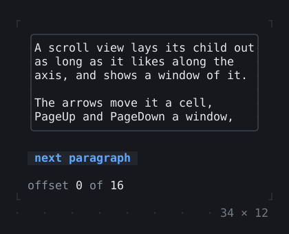
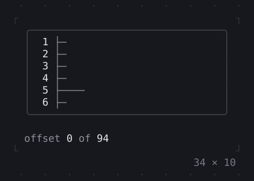
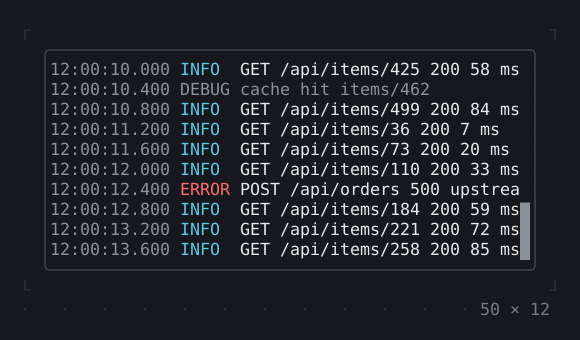
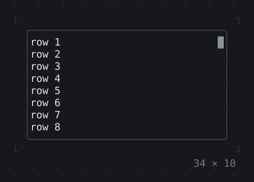

# Scrolling

Lists, scroll views and scrollbars, built as they scroll into view.

[All groups](README.md)

| | |
| --- | --- |
|  **[SingleChildScrollView](scrolling/singlechildscrollview.md)** One child scrolled in the room it is given: Tab to it, then the arrows, PageUp and PageDown, or the wheel over it. |  **[Scrollable](scrolling/scrollable.md)** What scrolls a viewport: here one of the page's own, a ruler that tells the scrollable how long it is as it is laid out. |
|  **[ListView](scrolling/listview.md)** Items built as they come into view, however many there are; the wheel and the keys scroll it. Separated, reversed as a chat, or kept on what it shows as items come before it. |  **[LogView](scrolling/logview.md)** Lines that keep coming, followed at the bottom: levels, a filter and a search, a count of the new lines while it is scrolled up. |
|  **[Scrollbar](scrolling/scrollbar.md)** A bar by the scrollable below it, its thumb where the window is; the thumb dragged and the track clicked scroll it. |  |

