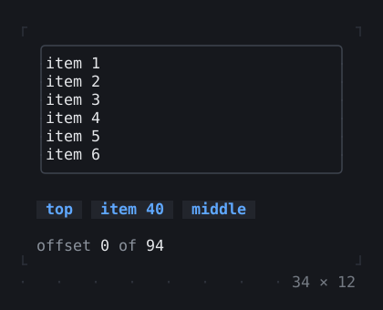
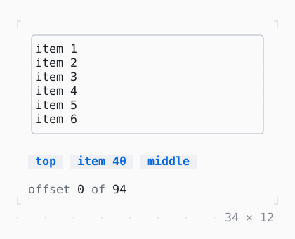

# ListView

Items built as they come into view, however many there are; the wheel and the keys scroll it. Separated, reversed as a chat, or kept on what it shows as items come before it.

| Dark | Light |
| --- | --- |
|  |  |

## Code

The Dart that builds it, as the gallery's Code tab shows it with the
options as they start:

```dart
const _count = 100;

final _list = ListController();

@override
void dispose() {
  _list.dispose();
  super.dispose();
}

@override
Widget build(BuildContext context) {
  final theme = Theme.of(context);
  return Column(
    mainAxisSize: .min,
    crossAxisAlignment: .start,
    gap: 1,
    children: [
      SizedBox(
        width: 34,
        height: 8,
        // the border primary while the focus is in it
        child: FocusBuilder(
          builder: (context, hasFocus, child) => Box(
            border: .all(
              type: .rounded,
              style: hasFocus ? theme.primary : theme.border,
            ),
            child: child,
          ),
          child: ListView.builder(
            itemCount: _count,
            controller: _list,
            wheelAcceleration: const WheelAcceleration(),
            itemBuilder: (context, i) => Text('item ${i + 1}'),
          ),
        ),
      ),
      Row(
        mainAxisSize: .min,
        gap: 1,
        children: [
          Button('top', onPressed: () => _list.jumpTo(0)),
          // the least move that shows it
          Button('item 40', onPressed: () => _list.ensureIndexVisible(39)),
          // at the top, built or not: where the estimate puts it
          Button('middle', onPressed: () => _list.jumpToIndex(_count ~/ 2)),
        ],
      ),
      ListenableBuilder(
        listenable: _list,
        builder: (context, _) => Text.rich([
          Span('offset ', theme.muted),
          Span('${_list.offset}'),
          Span(' of ', theme.muted),
          Span('${_list.position.maxOffset}'),
        ]),
      ),
    ],
  );
}
```

## Options

What the gallery lets you change, and what each starts at:

| option | values | starts at |
| --- | --- | --- |
| items | 100, 10 000, 1 000 000, growing, chat, feed | 100 |
| heights | one row, different | one row |
| separated | on, off | false |
| stuck by | stickToBottom, stickToEnd | stickToBottom |

## More

- API: [`ListView`](https://pub.dev/documentation/twk/latest/twk/ListView-class.html).
- Also in Scrolling: [SingleChildScrollView](singlechildscrollview.md), [Scrollable](scrollable.md), [LogView](logview.md), [Scrollbar](scrollbar.md).
- Live in the gallery:
  `dart run packages/gallery/bin/gallery.dart --route='#/scrolling/listview'`.
- [Scrolling](../scrolling.md) · [All groups](../README.md)
