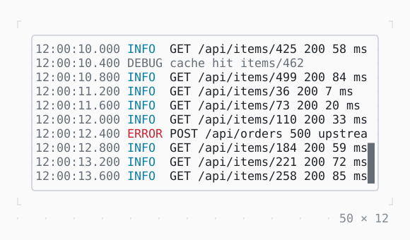

# LogView

Lines that keep coming, followed at the bottom: levels, a filter and a search, a count of the new lines while it is scrolled up.

| Dark | Light |
| --- | --- |
|  |  |

## Code

The Dart that builds it, as the gallery's Code tab shows it with the
options as they start:

```dart
final _log = LogController();
var _lines = 30;
late final Timer _timer;

@override
void initState() {
  super.initState();
  // the lines logged before it opens
  for (var i = 0; i < 30; i++) {
    _add(i);
  }
  // then one every 400 ms
  _timer = Timer.periodic(
    const Duration(milliseconds: 400),
    (_) => _add(_lines++),
  );
}

@override
void dispose() {
  _timer.cancel();
  _log.dispose();
  super.dispose();
}

/// Line [i]: what it says, at what level, and when.
void _add(int i) {
  final (level, text) = switch (i) {
    _ when i % 13 == 5 => (LogLevel.error, 'POST /api/orders 500 upstream timeout after 5000 ms'),
    _ when i % 7 == 3 => (
      LogLevel.warning,
      'slow query: SELECT * FROM items took ${300 + i * 29 % 900} ms',
    ),
    _ when i % 5 == 1 => (LogLevel.debug, 'cache hit items/${i * 37 % 500}'),
    _ => (LogLevel.info, 'GET /api/items/${i * 37 % 500} 200 ${3 + i * 13 % 90} ms'),
  };
  _log.add(
    text,
    level: level,
    time: DateTime(2026, 10, 19, 12).add(Duration(milliseconds: 400 * i)),
  );
}

@override
Widget build(BuildContext context) {
  final theme = Theme.of(context);
  return SizedBox(
    width: 50,
    height: 12,
    // the border primary while the focus is in it
    child: FocusBuilder(
      builder: (context, hasFocus, child) => Box(
        border: .all(
          type: .rounded,
          style: hasFocus ? theme.primary : theme.border,
        ),
        child: child,
      ),
      child: LogView(controller: _log),
    ),
  );
}
```

## Options

What the gallery lets you change, and what each starts at:

| option | values | starts at |
| --- | --- | --- |
| level | debug, info, warning, error | debug |
| filter | none, GET, slow | none |
| search | none, items, timeout | none |
| time | on, off | true |
| show level | on, off | true |
| wrap | on, off | false |
| live | on, off | true |
| scrollbar | always, onScroll, never | always |

## More

- API: [`LogView`](https://pub.dev/documentation/twk/latest/twk/LogView-class.html).
- Also in Scrolling: [SingleChildScrollView](singlechildscrollview.md), [Scrollable](scrollable.md), [ListView](listview.md), [Scrollbar](scrollbar.md).
- Live in the gallery:
  `dart run packages/gallery/bin/gallery.dart --route='#/scrolling/logview'`.
- [Scrolling](../scrolling.md) · [All groups](../README.md)
